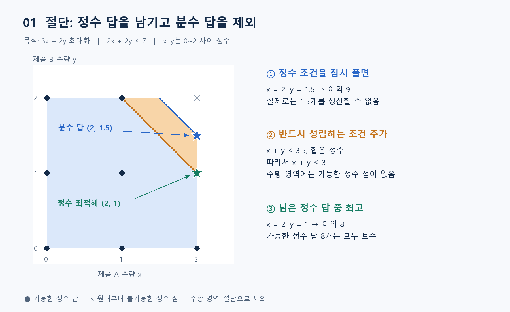
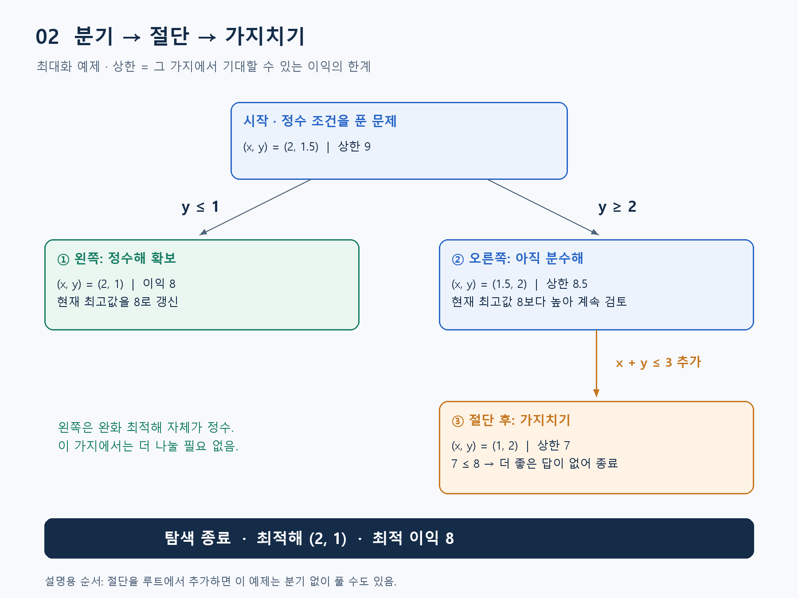

**알고리즘유형(엑셀 기준 적용 문제유형):** 순서·시간 편성 / 용량별 묶음·공정 구성 / 선택·투자·자원 배분 / 상태별 순차 의사결정 / 집합 분할·충돌 회피 / 위치·처리대상 배정

**알고리즘 대표도:** **4/5**

> 유형은 이 알고리즘이 등장하는 문제상황의 분류. 대표도는 인지도·보편성·검증 수준에 대한 기존 엑셀의 정성 평가이며, 5일수록 높음.

# Branch and Cut(분기절단법)

## 1. 한 문장으로 이해하기

**정수 조건을 잠시 풀어 가능성의 한계를 계산하고, 경우 나누기와 유효한 제약 추가를 결합해 최적해를 찾는 방법.** [1]

- **Branch(분기)**: “이 직원 배정 / 미배정”처럼 경우를 나누기.
- **Cut(절단)**: 가능한 정수 답은 보존하면서 불필요한 분수 답을 제외하는 제약 추가. [2]
- 기억할 질문: **정수로 결정해야 하나? 조건을 수식으로 표현할 수 있나? 더 좋은 답이 없는지 확인해야 하나?**

## 2. 언제 쓰는가

- 적합: 인력 배정, 설비 선택, 생산 수량처럼 0/1 또는 정수 결정이 있고 여러 조건을 동시에 지켜야 하는 상황.
- 이 문서의 범위: MILP(Mixed-Integer Linear Programming, 혼합 정수 선형계획). 일부 변수가 정수이고 목적·제약이 선형인 모델. 모든 변수가 정수인 문제도 포함.
- 준비할 입력: 결정변수·범위, 목적함수, 필수 제약, 비용·수요·용량, 허용 시간과 오차.
- 적용 판단: 단순 최단 경로에는 전용 알고리즘이 더 직접적. 정수 결정이 없는 선형 문제에는 LP(Linear Programming, 선형계획) 풀이부터 검토.
- 실무 출발점: 알고리즘을 직접 만들기보다 모델을 작성하고 최적화 솔버에 전달하는 방식 권장. 모델과 입력 자료가 틀리면 최적해도 업무 목적과 어긋남. [3]

## 3. 쉬운 로직과 숫자 예제

상자를 반 개 판매할 수 없는 생산계획을 생각하자. 계산을 쉽게 하려고 처음에는 반 개도 허용한 뒤, 실제 가능한 정수 수량으로 범위를 좁히는 방식.

- 두 제품의 수량 `x, y`: 각각 0·1·2개 중 선택.
- 이익 최대화: `z = 3x + 2y`. 제품마다 자원 2단위 사용, 총 7단위이므로 `2x + 2y ≤ 7`.
- 정수 조건을 푼 **완화 문제**의 답은 `(2, 1.5)`, 이익 9. 실제 판매는 불가능하지만 정수 최적값이 9를 넘을 수 없다는 **상한** 제공.
- 원래 제약에서 `x+y ≤ 3.5`. 합이 정수이므로 `x+y ≤ 3`도 반드시 성립. 이것이 **유효한 절단**. 분수 답을 제외하면서 가능한 정수 답 8개를 모두 보존.
- 실제 최적해는 `(2, 1)`, 이익 **8**. 이 예제는 모든 정수 조합을 열거하고 완화 문제를 별도로 풀어 검산한 자체 제작 예시.



*그림 1. 주황 영역을 제외해도 가능한 정수 점은 모두 남음. 파란 별은 정수 조건을 푼 답.*

## 4. 상세 로직: 어떻게 최적성을 확인하는가

아래는 최대화 문제 기준. **현재 최고값**은 찾은 정수해의 이익, **노드 상한**은 해당 가지에서 기대할 수 있는 최대 이익의 한계. [1]

1. 원래 모델을 루트에 넣고 정수 조건을 풀어 완화 문제 계산.
2. 유효한 절단을 선택적으로 추가하고 다시 계산. 모든 제약을 만족하는 정수해만 유지해야 함. [2]
3. 정수해를 찾으면 현재 최고값 갱신. 불가능한 가지나 상한이 현재 최고값 이하인 가지는 종료.
4. 분수 변수 값이 `v`이면 `변수 ≤ floor(v)`와 `변수 ≥ ceil(v)`로 분기. floor는 내림, ceil은 올림.
5. 남은 가지를 반복 처리. 더 나은 해가 나올 가지가 없으면 최적성 확인. 시간·오차 한도에 걸리면 종료 상태와 남은 간격을 함께 보고. [1]

범위가 유한한 최대화 모델의 개념용 의사코드:

```text
현재최고값 = -무한대; 후보 = {루트}
while 후보가 남고 제한에 도달하지 않음:
    노드 = 후보에서 하나 선택
    노드의 정수 조건을 풀어 계산
    if 실행 불가능: continue
    유효한 절단을 선택적으로 추가하고 재계산
    if 실행 불가능 또는 상한 <= 현재최고값: continue
    if 정수 조건도 만족:
        현재최고값과 해를 갱신; continue
    분수인 정수 변수를 골라 내림/올림 두 자식 생성
    두 자식을 후보에 추가
반환: 발견한 해, 종료 상태, 전체 한계값, 최적성 간격
```



*그림 2. 왼쪽에서 이익 8 확보 → 오른쪽 상한을 7로 낮춤 → 더 좋은 답이 없어 오른쪽 종료.*

- 설명을 위해 절단을 오른쪽 가지에서 추가한 순서. 이 예제는 루트에서 절단을 넣어 바로 풀 수도 있음. 실제 솔버의 탐색 순서를 재현한 로그는 아님.
- 최소화 문제에서는 방향이 반대: 완화값이 하한이며, 그 하한이 현재 최선 비용 이상이면 가지치기.

## 5. 대표 사례와 현재 엑셀 연결

- **생산계획**: 위 예제처럼 쪼갤 수 없는 제품 수량과 자원 제약 아래 최대 이익 선택.
- **사례 01 · 검사실 교대표**: 배정 여부를 0/1 변수로 표현. 자격 인원·야간근무·휴식 제약을 지키면서 야간 횟수 차이와 희망 휴무 위반의 가중합 최소화. 가중치는 담당자와 확인할 모델링 선택.
- **사례 67 · 진단키트 구매**: 키트 선택을 0/1로 표현. 모든 필수 항목을 한 번 이상 검사하도록 하면서 총구매비 최소화. 중복 기능 허용.
- 연결 파일: [알고리즘유형_신규상황_117개.xlsx](../알고리즘유형_신규상황_117개.xlsx)의 `문제상황 117개` 시트. 두 사례 모두 선형 정수모형으로 표현할 수 있다는 판단에 따른 적용 예시이며, 해당 사례를 여기서 실제 최적화한 것은 아님.

## 6. 왜 알려져 있는가

- **도입 근거**: IBM CPLEX는 혼합 정수모형 풀이에 분기절단 탐색을 사용한다고 명시. SCIP도 분기·절단 등을 결합한 솔버 프레임워크 제공. [1][3]
- **핵심 가치**: 좋은 해와 함께 “얼마나 더 좋아질 여지가 남았는가”를 한계값으로 평가하고, 조건이 충족되면 최적성까지 확인.
- **범위 구분**: 수리최적화 분야의 주요 방법. 일반 대중의 인지도와는 별개. 현재 엑셀 Top1~Top5 내 **10회 등장**은 이 자료의 구성 결과이며, 세계적 사용 순위나 속도 우위를 뜻하지 않음.

## 7. 한계와 비슷한 방법의 차이

- **계산 부담**: 문제가 커지면 탐색 가지가 급증할 수 있음. 절단을 많이 넣어도 각 완화 문제의 계산량이 늘어 항상 빨라지지는 않음. [4]
- **최적성 조건**: 유효한 절단·올바른 한계값·충분한 탐색이 전제. 실제 솔버는 수치 허용오차와 종료 기준도 확인. 시간 종료 후 발견한 해를 무조건 최적해로 부르면 안 됨.
- **Branch and Bound(분기한정법)**: 분기와 한계값으로 탐색. 분기절단법은 여기에 절단을 결합해 완화 문제를 강화.
- **Cutting-Plane Method(절단평면법)**: 절단 추가가 중심. 분기절단법은 필요할 때 경우 나누기도 함께 사용.
- **MILP**는 문제를 표현하는 형식이며, **Branch and Cut**은 그 문제를 푸는 방법. 둘은 같은 종류의 명칭이 아님.

## 8. 실제 사용 전 확인과 출처

- 먼저 변수·목적·필수 조건을 적고, 불명확한 가중치와 예외는 담당자에게 확인.
- 사용 환경에 정수 최적화 솔버가 있는지 확인. 작은 데이터로 모델 타당성을 먼저 검토.
- 결과를 원자료로 재계산: 정수 여부, 제약 위반, 목적값 일치 여부 점검.
- 최종 보고: **해·목적값·종료 상태·한계값·최적성 간격·실행 시간**. 해를 찾지 못한 시간 종료와 실행 불가능 판정을 구분. [3]

### 참고자료

- [1] [IBM — Branch and cut in CPLEX](https://www.ibm.com/docs/en/icos/22.1.2?topic=concepts-branch-cut-in-cplex): 분기, 완화, 현재 최선해, 한계값, 종료 조건.
- [2] [IBM — What are cuts?](https://www.ibm.com/docs/en/icos/22.1.1?topic=cuts-what-are): 절단의 정의와 적용 범위.
- [3] [SCIP — Overview](https://www.scipopt.org/doc/html/index.php): 지원 모형, 솔버 사용 예, 상태·한계값·간격 출력.
- [4] [COIN-OR — CBC Parameter Reference](https://github.com/coin-or/Cbc/blob/master/doc/cbc-parameters.md): 절단의 효과와 계산 시간 점검, 종료 설정.
- 확인일: 2026-11-05. 공식 개발사·프로젝트 문서를 바탕으로 재서술. 두 이미지는 본 문서의 숫자 예제를 그린 자체 제작 도식.
