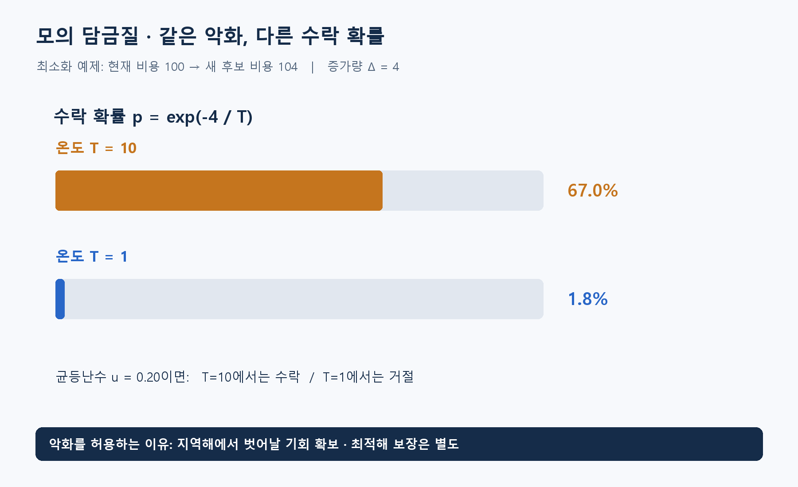

**알고리즘유형(엑셀 기준 적용 문제유형):** 순서·시간 편성 / 집합 분할·충돌 회피 / 위치·처리대상 배정 / 시설 입지 선정

**알고리즘 대표도:** **5/5**

> 유형은 이 알고리즘이 등장하는 문제상황의 분류. 대표도는 인지도·보편성·검증 수준에 대한 기존 엑셀의 정성 평가이며, 5일수록 높음.

# SA(Simulated Annealing, 모의 담금질)

## 1. 한 문장으로 이해하기

**좋아지는 이동은 받아들이고, 나빠지는 이동도 온도에 따른 확률로 허용하면서 좋은 조합을 찾는 탐색법.** SA는 Simulated Annealing(모의 담금질)의 약자. 금속을 가열한 뒤 식히는 과정에서 착안한 이름. [1][2]

- 핵심 구분: 지금 움직이는 **현재 해**와 지금까지 찾은 **최고의 해**를 따로 보관.
- 처음에는 다양한 조합을 탐색하고, 온도가 낮아질수록 개선하는 이동을 더 선호.

## 2. 언제 쓰는가

- 설비 배치, 방문 순서, 묶음 구성처럼 후보가 많고 작은 교환으로 새 후보를 만들 수 있는 상황.
- 준비할 것: 해의 표현, 비용 계산식, 이웃 생성 방법, 필수 제약 검사, 시작 온도·냉각 규칙·실행 시간.
- 예: 배치 순열에서 두 부서를 교환한 뒤 운반량×거리 합을 다시 계산. 모든 위치에 부서를 하나씩 두는 조건은 교환만으로 유지 가능.
- 목적함수가 연속적이거나 미분 가능할 필요는 없음. 다만 비용 평가가 느리면 이웃을 많이 탐색하지 못함.
- 최적성 증명이 필수라면 단독 사용의 한계가 있음. 작은 문제의 정확해나 별도 한계값을 비교 기준으로 준비하는 방법 권장.

## 3. 쉬운 로직과 숫자 예제

언덕에 둘러싸인 골짜기에서 더 낮은 곳을 찾는 상황. 당장 올라가는 움직임을 모두 막으면 현재 골짜기에 갇힐 수 있으므로, 초기에 일부 오르막도 허용.

- 비용을 최소화할 때 현재 비용 100, 새 후보 비용 104이면 증가량 `Δ=4`.
- 새 후보를 받아들일 확률은 `exp(-Δ/T)`. `T`는 양수인 온도이며 비용의 크기와 함께 조정할 설정값.
- `T=10`이면 약 **67.0%**, `T=1`이면 약 **1.8%**. 같은 악화라도 낮은 온도에서 훨씬 덜 허용.
- 균등난수 `u=0.20`을 뽑았다면 높은 온도에서는 수락하고 낮은 온도에서는 거절. 비용 96처럼 개선되는 후보는 수락.
- 이 계산은 수락 규칙을 보이는 자체 예제. 악화된 후보를 수락했다고 반드시 나중에 개선되는 것은 아님. [2]



## 4. 상세 로직

1. 실행 가능한 시작 해를 만들고 현재 해와 최고 해로 저장.
2. 현재 해에서 교환·이동 등으로 이웃 후보 생성. 필수 제약 위반은 거절하거나 명시한 복구 절차로 처리.
3. 비용 증가량 `Δ=후보비용−현재비용` 계산. 개선·동률이면 수락, 악화라면 확률 `exp(-Δ/T)`로 수락.
4. 수락 여부와 별도로 발견한 최고 해를 갱신하고 온도 감소. 예를 들어 `T←αT`, `0<α<1`인 기하 냉각 사용 가능.
5. 시간·반복 수·최저 온도 등 정한 기준에 도달하면 최고 해 반환. 냉각 규칙은 문제에 맞게 선택하며 보편적인 최적 설정은 없음. [2][3]

```text
현재 = 실행 가능한 시작 해; 최고 = 현재
while 시간과 온도 조건을 만족:
    후보 = 현재의 이웃 하나 생성
    if 후보가 필수 제약을 위반: 다음 반복
    Δ = 비용(후보) - 비용(현재)
    if Δ <= 0 또는 균등난수(0,1) < exp(-Δ/T):
        현재 = 후보
    if 비용(현재) < 비용(최고): 최고 = 현재
    냉각 규칙에 따라 T 갱신
return 최고
```

## 5. 대표 사례와 엑셀 연결

- 대표 적용: 시설 배치의 두 위치 교환, 순회의 방문 순서 변경. 좋은 이웃을 얼마나 빨리 평가하는지가 중요.
- 사례 **66**: 부서 12개의 위치를 바꿔 운반비 절감. 전체 재계산 외에 교환한 두 부서와 관련된 비용만 갱신하는 구현도 검토.
- 사례 **107**: 사진의 세로 짝과 슬라이드 순서를 함께 수정. 짝 구성과 순서 중 한 종류의 이동만 허용하면 탐색 범위가 제한될 수 있음.
- 사례 **115**: 센터 5곳 중 한 곳을 교체하고 수요지의 최근접 배정을 다시 계산. 정확히 5곳이라는 조건 유지.

## 6. 왜 알려져 있는가

- Kirkpatrick 등의 1983년 논문은 물리적 담금질과 조합 최적화의 연결을 제시한 대표 문헌. [1]
- 비용 함수와 이웃을 정의하면 여러 문제에 적용할 수 있어 범용 최적화 교육에서 다뤄지는 방법. 구현이 짧다는 점과 좋은 해를 얻는다는 점은 구분해야 함.
- 특정 문제에서 다른 휴리스틱보다 빠르거나 좋다는 보편적 우위는 없음. 초기해·온도·실행 예산을 맞춘 실험이 필요. [3]

## 7. 한계와 다른 방법의 차이

- 유한 시간에 전역 최적해를 찾았다는 증명은 일반적으로 제공하지 않음. 이론적 수렴 조건과 실무의 빠른 냉각은 구분.
- 너무 빨리 식히면 지역해에 머물고, 너무 천천히 식히면 개선 없이 시간을 소비할 수 있음.
- Hill Climbing(언덕 오르기)과 달리 나쁜 이동도 허용. LNS(Large Neighborhood Search, 대규모 이웃 탐색)는 이웃을 만드는 방법이고, SA 수락 규칙과 결합 가능.
- 확률식에 큰 비용 차이를 그대로 넣으면 수락률이 거의 0이 될 수 있음. 비용 단위와 온도 규모를 함께 확인.

## 8. 실제 사용 전 확인

- 필수 제약과 벌점으로 허용하는 조건을 구분. 벌점이 작아 불가능한 해를 우수한 해로 평가하지 않는지 검사.
- 같은 시간 예산에서 여러 난수 시드로 반복하고 최선·중앙값·편차·실행 가능 비율 기록.
- 시작 해, 현재 해, 최고 해를 혼동하지 않고 반환 결과의 제약과 비용을 원자료로 재계산.
- 작은 사례는 전체 열거로 최적값을 구해 비교. 큰 사례는 ‘발견한 최선해’라고 보고하고 최적성 증명 여부를 별도로 표시.

### 연결된 엑셀 사례

- 사례 번호: **09, 66, 106, 107, 115**. Top 1~5 출현 횟수: **5회**.
- 기준 자료: [알고리즘유형_신규상황_117개.xlsx](../알고리즘유형_신규상황_117개.xlsx)의 `문제상황 117개`·`알고리즘 집계` 시트. 적용 사례 설명은 모델링 해석이며, 해당 전체 데이터를 여기서 최적화한 결과는 아님.

### 참고자료

- [1] [Kirkpatrick et al. — Optimization by Simulated Annealing (1983)](https://doi.org/10.1126/science.220.4598.671): 물리적 담금질과 조합 최적화의 연결.
- [2] [Carnegie Mellon University — Simulated Annealing](https://www.math.cmu.edu/~gautam/c/2024-387/notes/10-simulated-annealing.html): 수락 확률, 온도, 탐색 원리.
- [3] [Bertsimas & Tsitsiklis — Simulated Annealing](https://www.mit.edu/~dbertsim/papers/Optimization/Simulated%20annealing.pdf): 수렴 조건과 적용 시 고려사항.
- 확인일: 2026-11-05. 대학 강의·연구논문·공식 프로젝트 문서를 바탕으로 재서술. 숫자 예제와 그림은 자체 제작했으며 계산값을 별도로 검산. 의사코드는 개념 설명용.
