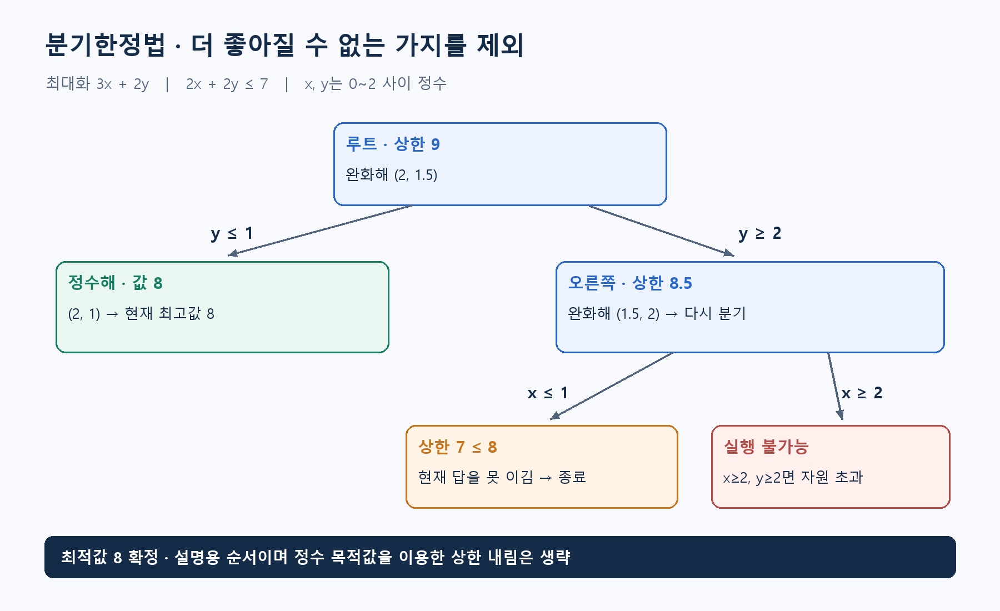

**알고리즘유형(엑셀 기준 적용 문제유형):** 순서·시간 편성 / 용량별 묶음·공정 구성 / 선택·투자·자원 배분 / 시설 입지 선정

**알고리즘 대표도:** **5/5**

> 유형은 이 알고리즘이 등장하는 문제상황의 분류. 대표도는 인지도·보편성·검증 수준에 대한 기존 엑셀의 정성 평가이며, 5일수록 높음.

# Branch and Bound(분기한정법)

## 1. 한 문장으로 이해하기

**경우를 나누되, 아무리 잘 풀어도 현재 답보다 좋아질 수 없는 경우는 통째로 제외하는 최적화 방법.** Branch는 경우 나누기, Bound는 각 경우에서 가능한 최적값의 한계. [1]

- 모든 조합을 끝까지 계산하는 대신, 확실한 근거로 일부 탐색을 생략.
- 좋은 답을 찾는 것과 그 답보다 나은 것이 없음을 확인하는 일을 함께 수행.

## 2. 언제 쓰는가

- 물품 선택, 설비 배정, 일정 편성처럼 경우의 수가 크지만 부분 문제의 낙관적 한계를 계산할 수 있을 때.
- 정수 최적화가 대표적이지만, 적절한 한계값을 만들 수 있는 비볼록 연속 최적화에도 사용. 이 문서는 정수 선형모형 중심. [1]
- 입력: 결정변수·범위, 목적함수, 제약, 분기 규칙, 한계값 계산법, 시간·정확도 기준.
- 정수 조건을 풀어 얻는 LP(Linear Programming, 선형계획) 최적값은 최대화에서는 상한, 최소화에서는 하한.
- 현실적인 일정 하나의 비용처럼 실행 가능한 해의 값은 반대쪽 한계를 제공. 실행 불가능한 반올림 결과는 비교 기준으로 쓸 수 없음.

## 3. 쉬운 로직과 숫자 예제

매장을 고르는데 어떤 지역은 가장 낙관적으로 잡아도 이익이 7이고, 이미 이익 8인 매장을 찾았다면 그 지역의 후보를 더 볼 필요가 없다는 생각.

- 최대화 `z=3x+2y`, 제약 `2x+2y≤7`, `0≤x,y≤2`, 두 변수는 정수.
- 정수 조건을 푼 답 `(2,1.5)`의 값 **9**는 상한. 정수 답 자체가 아님.
- `y≤1`과 `y≥2`로 분기. 왼쪽은 `(2,1)`로 **8**을 확보하고 종료.
- 오른쪽은 `(1.5,2)`로 상한 **8.5**. 다시 `x≤1`과 `x≥2`로 나누면 각각 상한 **7**, 실행 불가능.
- 두 가지 모두 이익 8을 넘는 정수해를 만들지 못하므로 최적값은 **8**. 분기 원리를 보여주려고 정수 목적값을 이용한 상한 내림은 생략한 순서.



## 4. 상세 로직

1. 원래 문제를 루트에 넣고 실행 가능한 초기해가 있으면 현재 최고값 설정.
2. 남은 노드 하나를 골라 완화 문제 계산. 최대화라면 그 값이 해당 노드의 상한.
3. 실행 불가능하거나 상한이 현재 최고값 이하이면 가지치기. 완화 최적해가 정수이면 최고값을 갱신하고 해당 노드 종료.
4. 분수인 정수변수 값 `v`를 골라 `변수≤floor(v)`와 `변수≥ceil(v)` 생성. 두 자식이 부모의 가능한 정수해를 빠짐없이 포함해야 함.
5. 반복 후 후보가 없어지면 최적성 확인. 시간 종료라면 남은 노드의 한계값까지 보고. 아래는 유한 범위 최대화 문제의 개념 절차. [1][2]

```text
최고 = 실행 가능한 초기해의 값 또는 -무한대
후보 = {루트}
while 후보가 남고 시간 한도 이내:
    노드 = 후보에서 선택; 완화 문제 계산
    if 실행 불가능 또는 노드 상한 <= 최고: continue
    if 완화해가 정수:
        최고와 답 갱신; continue
    분수인 정수변수를 골라 내림/올림으로 분기
    두 자식을 후보에 추가
return 답, 종료 상태, 남은 한계값
```

## 5. 대표 사례와 엑셀 연결

- 대표 적용: Knapsack Problem(배낭 문제). 물품을 담을지 나누고, 일부 물품을 쪼갤 수 있다고 가정해 낙관적 가치 계산.
- 사례 **02**: 작업대를 배정하며 선후관계와 주기시간을 검사. 총 작업시간을 주기시간으로 나눈 올림값은 작업대 수의 기본 하한이지만 선후 제약까지 모두 반영한 최적값은 아님.
- 사례 **68**: 4대 가공기에 주문 배정. 총 처리시간/4와 가장 긴 주문 시간의 최댓값은 완료시각의 기본 하한.
- 사례 **115**: 센터 선택 여부를 분기. 아직 확정하지 않은 센터의 선택을 완화해 낙관적 운송비를 계산하는 모델 검토.

## 6. 왜 알려져 있는가

- 분기·한계·가지치기라는 구조로 여러 최적화 문제를 다룰 수 있고, 최적성 확인의 근거를 남길 수 있음. 대학 최적화 강의와 정수 솔버의 핵심 설명에 등장. [1][2]
- 문제별 휴리스틱을 초기해 생성에 결합할 수 있음. 초기에 좋은 해를 찾으면 더 많은 가지를 일찍 제외할 가능성이 있음.
- 빠르다는 보장은 없음. 한계값이 느슨하면 사실상 많은 경우를 살펴야 함.

## 7. 한계와 다른 방법의 차이

- 최악의 경우 계산량이 지수적으로 증가. 한계값을 강하게 만드는 비용과 줄어드는 탐색량을 함께 평가해야 함. [1]
- Backtracking(백트래킹)은 불가능한 부분 선택을 되돌리는 데 초점. 분기한정법은 목적값의 한계로도 제거.
- Branch and Cut(분기절단법)은 유효한 절단을 추가해 완화 문제를 강화한 확장. 분기한정법 자체에 절단이 반드시 포함되는 것은 아님.
- 동일한 최적해를 모두 찾으려면 동률 가지 제거 규칙을 바꿔야 함. `상한≤현재 최고값`은 최적해 하나만 필요한 경우의 규칙.

## 8. 실제 사용 전 확인

- 최대화·최소화에 맞게 한계값 방향을 확인하고, 작은 사례에서 가지치기 때문에 최적해가 사라지지 않는지 검산.
- 최적값·발견한 최선값·솔버 한계값을 서로 다른 항목으로 기록.
- 해가 없다는 증명과 시간 내 해를 못 찾은 상태를 구분.
- 수치 허용오차, 정수 허용오차, 최적성 간격 기준을 결과와 함께 보관.

### 연결된 엑셀 사례

- 사례 번호: **02, 10, 68, 115**. Top 1~5 출현 횟수: **4회**.
- 기준 자료: [알고리즘유형_신규상황_117개.xlsx](../알고리즘유형_신규상황_117개.xlsx)의 `문제상황 117개`·`알고리즘 집계` 시트. 적용 사례 설명은 모델링 해석이며, 해당 전체 데이터를 여기서 최적화한 결과는 아님.

### 참고자료

- [1] [Boyd & Mattingley — Branch and Bound Methods](https://web.stanford.edu/class/ee364b/lectures/bb_notes.pdf): 한계값, 분기, 가지치기, 최악의 계산량.
- [2] [IBM — Branch and cut in CPLEX](https://www.ibm.com/docs/en/icos/22.1.2?topic=concepts-branch-cut-in-cplex): 정수 탐색 트리와 현재 최선해, 종료 조건.
- 확인일: 2026-11-05. 대학 강의·연구논문·공식 프로젝트 문서를 바탕으로 재서술. 숫자 예제와 그림은 자체 제작했으며 계산값을 별도로 검산. 의사코드는 개념 설명용.
