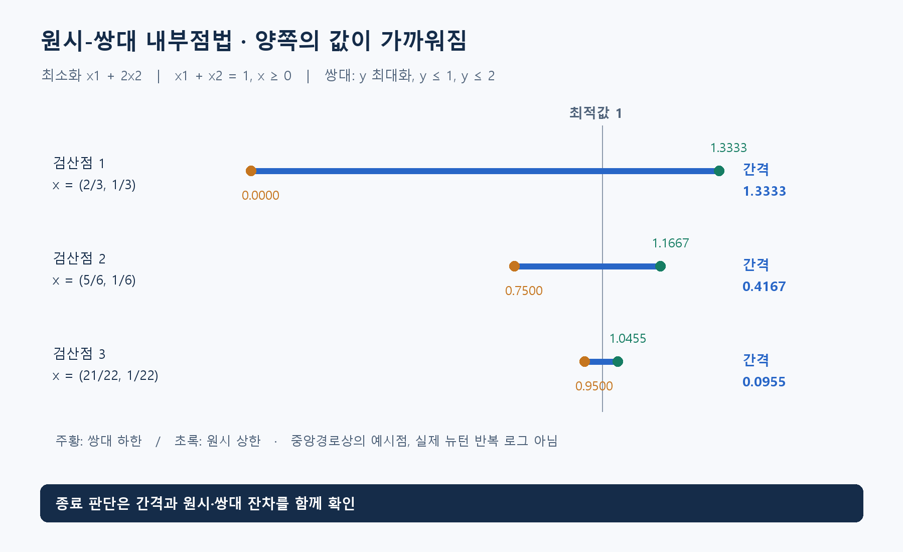

**알고리즘유형(엑셀 기준 적용 문제유형):** 순서·시간 편성 / 기간별 생산·재고 계획 / 선택·투자·자원 배분

**알고리즘 대표도:** **4/5**

> 유형은 이 알고리즘이 등장하는 문제상황의 분류. 대표도는 인지도·보편성·검증 수준에 대한 기존 엑셀의 정성 평가이며, 5일수록 높음.

# Primal-Dual Interior-Point Method(원시-쌍대 내부점법)

## 1. 한 문장으로 이해하기

**원래 문제의 해와 그 값의 한계를 주는 쌍대 문제의 해를 함께 조정하며, 최적성 조건의 오차를 줄이는 방법.** 내부점은 부등식 경계에 바로 붙기보다 양의 여유를 유지하며 접근한다는 뜻. [1]

- 하나의 고정 코드 이름보다는 관련 알고리즘 계열의 명칭.
- 이 문서는 LP(Linear Programming, 선형계획)의 기본 구조를 설명. 정수 배정을 직접 보장하는 방법은 아님.

## 2. 언제 쓰는가

- 생산·재고의 연속 물량, 원료 배합, 볼록한 투자 비중 최적화처럼 연속변수와 선형 또는 적절한 볼록 구조가 있을 때.
- 입력: 목적 계수, 제약 행렬, 우변, 변수 범위, 볼록성, 수치 허용오차. 행렬이 얼마나 희소한지도 실행 시간에 영향.
- ‘내부를 이동한다’고 원래 등식을 매 반복마다 반드시 정확히 만족하는 것은 아님. 초기 실행 불가능점을 허용하는 변형도 있으며, 마지막에는 잔차까지 검사해야 함. [1]
- 사람 수나 선택 여부가 반드시 정수인 문제는 정수 모형이 필요. 내부점법은 그 연속 완화나 다른 하위 문제를 푸는 데 사용 가능.

## 3. 쉬운 로직과 숫자 예제

제품을 만드는 실제 계획과 ‘아무리 싸게 만들어도 이보다 내려갈 수 없다’는 비용 기준을 함께 좁혀 간다고 생각하면 됨.

- 원시 문제: `x1+2x2` 최소화, `x1+x2=1`, `x1,x2≥0`.
- 쌍대 문제: `y` 최대화, `y≤1`, `y≤2`. 실행 가능한 원시값은 상한, 쌍대값은 하한.
- `x=(2/3,1/3), y=0`이면 상한 1.3333, 하한 0. 간격은 1.3333.
- `x=(5/6,1/6), y=3/4`이면 상한 1.1667, 하한 0.75. 간격은 0.4167.
- 최적점은 `x=(1,0), y=1`, 양쪽 값 **1**. 그림의 중간 점은 중앙경로 조건을 만족하도록 만든 검산점이며 실제 솔버의 반복 로그는 아님.



## 4. 상세 로직

표준 원시 문제를 `min cᵀx, Ax=b, x≥0`, 쌍대를 `max bᵀy, Aᵀy+s=c, s≥0`로 두자. `s`는 쌍대 여유, `c`는 단위 비용, `A,b`는 제약 자료.

1. 양수인 `x,s`와 쌍대변수 `y` 초기화. 원시 잔차 `Ax−b`, 쌍대 잔차 `Aᵀy+s−c` 계산.
2. 최적점의 상보성 `xᵢsᵢ=0`을 바로 강요하는 대신, 양수 `μ`에 대해 `xᵢsᵢ≈μ`인 경로 추적.
3. 세 조건을 함께 선형화한 Newton Method(뉴턴 방법)의 연립방정식으로 이동 방향 계산.
4. `x,s`가 양수를 유지하고 잔차가 적절히 줄도록 보폭 선택. `μ`도 줄이면서 반복.
5. 원시·쌍대 실행 가능성과 간격이 모두 허용 기준에 들어오면 종료. 등식을 만족할 때 `cᵀx−bᵀy=xᵀs`. [1]

```text
x, s를 양수로 초기화; y 초기화
while 종료 기준 미충족:
    원시 잔차, 쌍대 잔차, 상보성 오차 계산
    μ와 중심화 목표 결정
    선형화한 연립방정식으로 Δx, Δy, Δs 계산
    양수성과 오차 감소를 고려해 보폭 α 선택
    x, y, s를 α만큼 갱신
    시간·수치 실패·실행 불가능 판정 상태 확인
return 해, 목적값, 잔차, 간격, 종료 상태
```

## 5. 대표 사례와 엑셀 연결

- 대표 적용: 대규모 연속 자원 배분과 볼록 최적화. Stanford의 PDCO(Primal-Dual interior method for Convex Objectives)는 실제 공개 구현 사례. [2]
- 사례 **06**: 생산·외주·재고를 연속량으로 두고 월별 물량수지와 용량을 연결하는 선형모형.
- 사례 **13**: 공분산이 양의 준정부호이면 분산은 볼록 이차함수. 비례 거래비용의 절댓값은 보조변수로 표현 가능. 기대수익·제약·가중치는 모델의 가정.
- 사례 **65**: 작업별 단축량과 시작시각을 연속변수로 두어 준공기한을 만족하는 비용 최소화.

## 6. 왜 알려져 있는가

- 선형·이차·원뿔 최적화 등 주요 볼록 문제에 맞춘 원시-쌍대 방법이 발전했고, 교재와 공개 솔버에서 다뤄지는 중심 방법. [1][2]
- 실제 계획의 오차와 최적성 간격을 함께 평가한다는 점이 유용. 모든 문제에서 단체법보다 빠르다는 뜻은 아님.
- 계산의 핵심은 반복마다 푸는 선형 시스템. 희소 행렬 구조를 잘 이용하는 구현이 성능에 중요.

## 7. 한계와 다른 방법의 차이

- 비볼록 문제에 같은 모양의 식을 적용한다고 전역 최적성이 보장되지는 않음. 볼록성·실행 가능성·쌍대성 조건을 확인.
- Simplex Method(단체법)은 기저를 바꾸는 방식. 내부점법은 양의 여유를 가진 점들을 조정하며 접근.
- 경계에 매우 가까워지거나 계수 크기가 크게 다르면 수치 문제가 발생 가능. 단위 조정과 종료 잔차 확인이 필요.
- 중앙경로를 설명하는 식과 실제 솔버의 예측·보정, 초기화, 실행 불가능 검출 절차는 구분해야 함.

## 8. 실제 사용 전 확인

- 변수의 연속/정수 구분과 목적의 볼록성을 먼저 확인.
- 최종 변수값으로 제약 잔차를 직접 계산. 작은 간격 하나만 보고 성공으로 판단하지 않기.
- 목적값, 원시·쌍대 잔차, 간격, 상태, 시간을 저장하고 작은 선형 사례는 다른 LP 방법과 비교.
- 행렬 계수의 단위와 규모를 점검하고 수치 실패를 실행 불가능으로 오인하지 않기.

### 연결된 엑셀 사례

- 사례 번호: **06, 12, 13, 65**. Top 1~5 출현 횟수: **4회**.
- 기준 자료: [알고리즘유형_신규상황_117개.xlsx](../알고리즘유형_신규상황_117개.xlsx)의 `문제상황 117개`·`알고리즘 집계` 시트. 적용 사례 설명은 모델링 해석이며, 해당 전체 데이터를 여기서 최적화한 결과는 아님.

### 참고자료

- [1] [Boyd & Vandenberghe — Convex Optimization, §11.7](https://web.stanford.edu/~boyd/cvxbook/bv_cvxbook.pdf): 원시-쌍대 조건, 뉴턴 방향, 잔차와 간격.
- [2] [Stanford Systems Optimization Laboratory — PDCO](https://web.stanford.edu/group/SOL/software/pdco/): 볼록 목적·선형 제약의 공개 원시-쌍대 구현.
- 확인일: 2026-11-05. 대학 강의·연구논문·공식 프로젝트 문서를 바탕으로 재서술. 숫자 예제와 그림은 자체 제작했으며 계산값을 별도로 검산. 의사코드는 개념 설명용.
