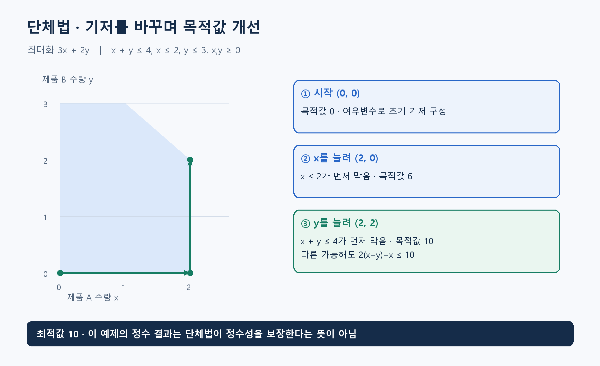

**알고리즘유형(엑셀 기준 적용 문제유형):** 순서·시간 편성 / 기간별 생산·재고 계획 / 선택·투자·자원 배분

**알고리즘 대표도:** **5/5**

> 유형은 이 알고리즘이 등장하는 문제상황의 분류. 대표도는 인지도·보편성·검증 수준에 대한 기존 엑셀의 정성 평가이며, 5일수록 높음.

# Simplex Method(단체법)

## 1. 한 문장으로 이해하기

**선형 제약으로 만든 가능 영역에서 기저를 바꾸며 목적값을 개선하는 선형계획 알고리즘.** 2차원 그림에서는 다각형의 꼭짓점을 따라 움직이는 모습으로 이해할 수 있음. [1]

- Simplex Method(단체법)는 LP(Linear Programming, 선형계획) 풀이 방법.
- 이름이 비슷한 Nelder-Mead Method(넬더-미드 방법)는 별개의 비선형 최적화 방법.

## 2. 언제 쓰는가

- 생산량·배합량·수송량처럼 연속 수량을 정하고 목적과 조건이 선형으로 표현될 때.
- 입력: 비용 또는 이익 계수, 자원 계수, 제약의 상·하한, 변수 범위. 서로 다른 기간과 단위를 섞지 않는 것이 먼저.
- 분할 가능한 리터·톤의 생산계획에는 자연스럽지만, 채용 인원·장비 개수에 정수성이 필요하면 그대로 적용할 수 없음.
- 어떤 계수를 바꾸면 비용이 어떻게 달라지는지 검토할 때 기저·쌍대정보도 활용 가능. 다만 민감도 해석의 유효 범위까지 확인해야 함.
- 초기 실행 가능 기저가 없는 문제에는 이를 찾는 Phase I(1단계) 같은 절차가 필요. [1]

## 3. 쉬운 로직과 숫자 예제

제품 A와 B를 연속량으로 생산한다고 하자. `x,y≥0`, `x+y≤4`, `x≤2`, `y≤3` 아래 이익 `3x+2y` 최대화.

- `(0,0)`에서 시작하면 이익 **0**.
- A를 먼저 늘리면 `x≤2`가 먼저 막아 `(2,0)`, 이익 **6**.
- 이어 B를 늘리면 `x+y≤4`가 먼저 막아 `(2,2)`, 이익 **10**.
- 최적성의 별도 확인: `3x+2y=2(x+y)+x≤2×4+2=10`. 실제로 10을 달성했으므로 최적값은 **10**.
- 이동 순서는 선택 규칙에 따라 달라질 수 있음. 이 예제의 정수 결과는 우연이며 단체법이 정수성을 보장해서가 아님.



## 4. 상세 로직

1. 부등식에 Slack Variable(여유변수)을 도입해 등식으로 정리. 예를 들어 `x+y+s1=4`, `x+s2=2`, `y+s3=3`.
2. 실행 가능한 기저를 확보. 이 예제에서는 `x=y=0`, 여유변수 `s1=4,s2=2,s3=3`이 시작 기저.
3. Reduced Cost(감소비용)를 확인해 목적을 개선할 진입변수 선택. 부호 판정은 최소화·최대화 및 표기 방식에 따라 달라짐.
4. 다른 변수가 음수가 되지 않게 증가할 수 있는 양을 최소비율 검사로 결정. 한계에 먼저 도달한 기저변수가 이탈.
5. Pivot(피벗)으로 기저 교체 후 반복. 개선할 진입변수가 없으면 현재 기저가 최적. 개선 방향에 한계가 없으면 비유계 가능성을 판정. [1]

```text
표준형 변환 후 실행 가능한 기저 확보
if 1단계에서도 실행 가능 기저 없음: 실행 불가능 반환
while 개선할 감소비용이 존재:
    진입변수 선택
    허용 방향에 대해 최소비율 검사
    if 이동을 제한하는 행이 없음: 비유계 반환
    이탈변수 선택 후 피벗
    퇴화·반복 기저와 수치 오차 점검
return 변수값, 목적값, 기저, 종료 상태
```

## 5. 대표 사례와 엑셀 연결

- 대표 적용: 배합 문제. 원료비를 최소화하면서 각 성분의 상·하한과 총생산량을 만족시키는 연속 선형모형.
- 사례 **114**: 원료 20종으로 100톤 배합. 성분의 선형 혼합 가정과 원료 가용량을 확인한 뒤 모델 구성.
- 사례 **06**: 정규 생산·잔업·외주·재고 비용의 합 최소화. 품절 허용 여부와 초기·말기 재고 조건을 명확히 설정.
- 사례 **65**: 작업 소요일 단축량과 준공기한의 선형 관계를 이용. 인력 공유 제약이 없다는 조건이 모형을 단순화함.

## 6. 왜 알려져 있는가

- 선형계획의 기저·쌍대·민감도를 함께 이해하는 대표 방법으로 대학 알고리즘·운용과학 수업에서 다룸. [1]
- 실무 구현에는 Revised Simplex(개정 단체법), Dual Simplex(쌍대 단체법) 등이 사용됨. 공개 솔버 HiGHS도 쌍대 개정 단체법을 제공. [2]
- 선형모형의 구조를 이용한다는 장점이 있지만, 내부점법과의 속도 우위는 문제 규모·희소성·초기정보에 따라 달라짐.

## 7. 한계와 다른 방법의 차이

- 최악의 경우 많은 피벗이 필요하며, 퇴화에서는 기저가 달라져도 목적값이 그대로일 수 있음.
- 일부 피벗 규칙은 같은 기저를 반복하는 순환을 만들 수 있으므로 방지 규칙이나 검증된 솔버가 필요. ‘매번 엄격히 개선’은 일반적인 설명으로 부정확. [3]
- 분기절단법은 정수 조건까지 다루는 탐색 틀. 단체법은 그 과정에서 연속 완화를 푸는 하위 방법이 될 수 있음.
- 큰 계수 차이와 거의 중복된 제약은 수치 불안정을 유발할 수 있어 결과의 제약 잔차를 확인해야 함.

## 8. 실제 사용 전 확인

- 총생산량·용량·단위 비용이 같은 시간 기준인지 점검하고 모든 변수의 범위를 명시.
- 결과에서 목적값을 재계산하고 각 제약의 위반량과 여유를 확인.
- 실행 불가능, 비유계, 최적, 시간 종료 상태를 구분. 비유계이면 누락한 상한이나 잘못된 비용 부호부터 점검.
- 정수 결과가 필요한 문제의 연속해를 단순 반올림해 제출하지 않기. 반올림은 제약이나 최적성을 깨뜨릴 수 있음.

### 연결된 엑셀 사례

- 사례 번호: **06, 65, 114**. Top 1~5 출현 횟수: **3회**.
- 기준 자료: [알고리즘유형_신규상황_117개.xlsx](../알고리즘유형_신규상황_117개.xlsx)의 `문제상황 117개`·`알고리즘 집계` 시트. 적용 사례 설명은 모델링 해석이며, 해당 전체 데이터를 여기서 최적화한 결과는 아님.

### 참고자료

- [1] [MIT 6.046J — Lecture 15: Linear Programming](https://ocw.mit.edu/courses/6-046j-design-and-analysis-of-algorithms-spring-2015/927a49adf7b3c4a6de8c31393509552c_MIT6_046JS15_lec15.pdf): 기저, 피벗, 선형계획의 기본 구조.
- [2] [SciPy — linprog with HiGHS dual simplex](https://docs.scipy.org/doc/scipy/reference/optimize.linprog-highs-ds.html): 쌍대 개정 단체법 구현과 종료 상태.
- [3] [Hall & McKinnon — Simplex cycling examples](https://arxiv.org/abs/math/0012242): 퇴화와 순환의 실제 반례.
- 확인일: 2026-11-05. 대학 강의·연구논문·공식 프로젝트 문서를 바탕으로 재서술. 숫자 예제와 그림은 자체 제작했으며 계산값을 별도로 검산. 의사코드는 개념 설명용.
