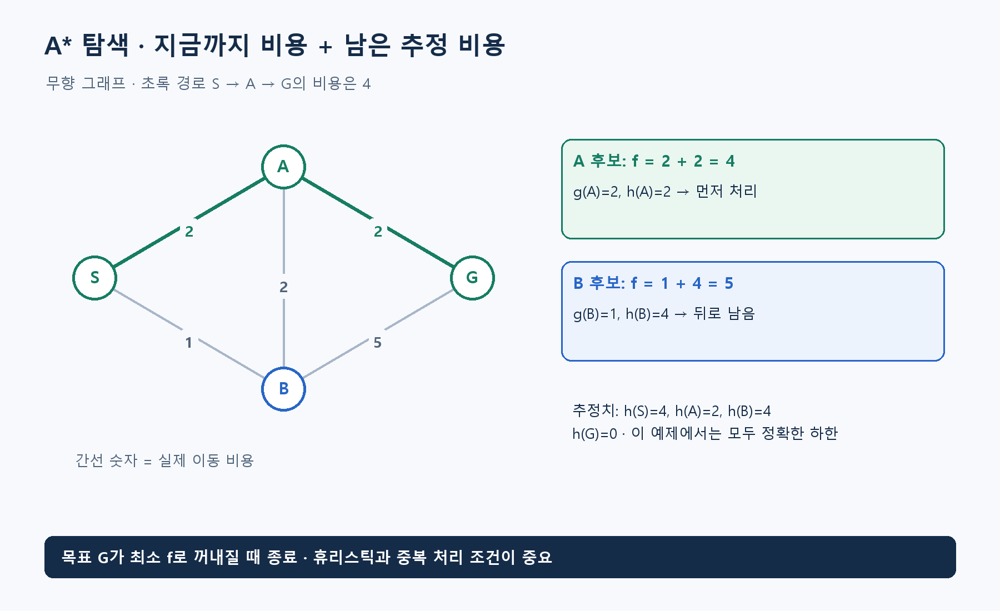

**알고리즘유형(엑셀 기준 적용 문제유형):** 경로·방문 순회 / 상태 공간·퍼즐 탐색

**알고리즘 대표도:** **5/5**

> 유형은 이 알고리즘이 등장하는 문제상황의 분류. 대표도는 인지도·보편성·검증 수준에 대한 기존 엑셀의 정성 평가이며, 5일수록 높음.

# A* Search(에이스타 탐색)

## 1. 한 문장으로 이해하기

**지금까지 든 비용과 목표까지 남은 비용의 추정치를 합쳐, 유망한 상태부터 탐색하는 최단 경로 방법.** A*는 ‘에이스타’로 읽는 이름이며 풀어 쓰는 약자는 아님. [1]

- 우선순위 `f(n)=g(n)+h(n)`에서 `g`는 이미 든 비용, `h`는 남은 비용의 추정치.
- 목표에 가까워 보이는 정도만 쓰는 탐욕 탐색과 달리, 도착하기까지 지불한 비용도 포함.

## 2. 언제 쓰는가

- 출발·목표 상태가 있고 이동 비용과 유효한 후속 상태를 만들 수 있으며, 남은 비용의 좋은 하한을 구할 수 있을 때.
- 지도 경로, 게임 이동, 퍼즐의 최소 이동 수가 대표적. 상태는 좌표뿐 아니라 퍼즐 전체 배열일 수도 있음.
- 준비할 것: 상태 표현, 이동 규칙, 비용, 목표 판정, 휴리스틱, 부모 기록, 중복 상태 처리.
- 이 문서는 유한 그래프와 비음수 이동 비용을 전제로 설명. 음수 비용을 가진 문제에 그대로 적용하지 않기.
- 최적성을 유지하려면 휴리스틱이 실제 남은 최단 비용을 과대평가하지 않아야 함. 닫힌 상태를 다시 열지 않는 구현에는 일관성까지 확인. [1]

## 3. 쉬운 로직과 숫자 예제

지도에서 길을 고르며 ‘여기까지 몇 분 + 여기서 목적지까지 적어도 몇 분’을 비교하는 방식.

- 무향 도로: `S-A=2`, `S-B=1`, `A-B=2`, `A-G=2`, `B-G=5`.
- 목표 G까지의 추정값을 `h(S)=4, h(A)=2, h(B)=4, h(G)=0`으로 설정. 이 작은 예제에서는 실제 남은 최단 비용과 같아 유효한 하한.
- S에서 A를 보면 `g=2,h=2,f=4`. B는 `g=1,h=4,f=5`. A를 먼저 꺼냄.
- A를 통해 G에 도달하면 `g=4,h=0,f=4`. G가 우선순위 큐에서 꺼내질 때 경로 `S→A→G`, 비용 **4** 확정.
- 목표를 처음 발견한 순간에 끝내는 것과 목표를 최소 우선순위로 꺼낼 때 끝내는 것은 다름. [1]



## 4. 상세 로직

1. 시작 비용 `g(S)=0`, 다른 상태는 무한대로 초기화. 최소 `f`를 꺼내는 우선순위 큐 준비.
2. 상태를 꺼내 오래된 기록이면 건너뛰기. 유효한 목표 상태가 꺼내지면 부모 포인터로 경로 복원.
3. 이웃 v의 새 비용 `g(u)+c(u,v)`가 기존 g보다 작으면 g와 부모를 갱신하고 새 f로 큐에 넣기.
4. 이미 처리한 상태라도 더 좋은 g가 발견되면 필요한 재탐색 허용. 일관된 휴리스틱이라면 표준 조건에서 확정 상태를 재확장할 필요가 없음.
5. 큐가 비면 도달 불가능. 최적성의 휴리스틱 조건은 코드의 중복 처리 방식과 함께 검토. [1][2]

```text
g[S]=0; 나머지 g=무한대; 큐에 (h(S),0,S) 삽입
while 큐가 비지 않음:
    (f,기록g,u) = 최소 항목 꺼내기
    if 기록g != g[u]: continue
    if u가 목표: 부모를 따라 경로 반환
    for 각 이동 u→v:
        새비용 = g[u] + 이동비용(u,v)
        if 새비용 < g[v]:
            g[v]=새비용; 부모[v]=u
            큐에 (g[v]+h(v),g[v],v) 삽입
return 도달 불가능
```

## 5. 대표 사례와 엑셀 연결

- 사례 **55**: 루마니아 지도에서 직선거리를 도로 거리의 하한으로 사용. 실제 도로 가중치와 일관되게 정의됐는지 확인.
- 같은 사례의 4방향 격자는 간선비용이 1 이상이므로 Manhattan Distance(맨해튼 거리)가 하한. 이동 규칙에 대각선을 추가하면 추정식도 다시 검토.
- 사례 **109**: 8퍼즐에서 각 숫자 타일의 목표 위치까지 맨해튼 거리 합을 사용하고 빈칸은 제외. 한 번의 이동으로 한 타일이 한 칸 움직인다는 조건에 의존.
- 유명 지도나 퍼즐은 문제 예시이고 A*는 그것을 푸는 방법. 지도 자체가 하나의 알고리즘 이름은 아님.

## 6. 왜 알려져 있는가

- 인공지능 교재의 휴리스틱 탐색을 설명하는 대표 방법. AIMA는 `g+h` 평가와 허용성·일관성의 역할을 다룸. [1][2]
- 문제 지식을 추정치로 넣어 탐색 방향을 바꿀 수 있음. 좋은 휴리스틱은 탐색량을 줄일 수 있지만 계산 자체가 비싸면 시간 개선은 줄어들 수 있음.
- 추정값을 모두 0으로 두면 Uniform-Cost Search(균일 비용 탐색), 일반적인 그래프 구현에서는 다익스트라 방식과 연결됨.

## 7. 한계와 다른 방법의 차이

- `허용성`: h가 실제 남은 비용 이하. `일관성`: 모든 간선에 대해 `h(u)≤c(u,v)+h(v)`, 목표의 h는 0.
- 닫힌 상태를 무조건 버리면서 일관성이 없는 h를 쓰면 최적해를 놓칠 수 있음. 과대추정도 일반적인 최적성 보장을 깨뜨림.
- 탐색 후보와 방문 정보를 저장하므로 상태 공간이 크면 메모리가 먼저 부족해질 수 있음.
- 경로 하나를 찾는 데 적합하지만 모든 도로를 방문하는 배달 순회를 이 알고리즘 하나로 해결하는 것은 아님.

## 8. 실제 사용 전 확인

- 휴리스틱을 어떤 하한에서 유도했는지 적고 작은 그래프의 정확한 거리와 비교.
- 비용 단위, 방향성, 벽·금지 이동, 상태 키와 부모 복원을 확인.
- 같은 입력에서 다익스트라와 최적 비용을 비교하고 확장 상태 수·최대 큐 크기·시간 측정.
- 시간 제한으로 중단했다면 발견한 경로를 최적 경로라고 단정하지 않기.

### 연결된 엑셀 사례

- 사례 번호: **55, 109**. Top 1~5 출현 횟수: **2회**.
- 기준 자료: [알고리즘유형_신규상황_117개.xlsx](../알고리즘유형_신규상황_117개.xlsx)의 `문제상황 117개`·`알고리즘 집계` 시트. 적용 사례 설명은 모델링 해석이며, 해당 전체 데이터를 여기서 최적화한 결과는 아님.

### 참고자료

- [1] [Russell & Norvig — AIMA, Informed Search](https://aima.cs.berkeley.edu/4th-ed/pdfs/newchap04.pdf): A* 평가, 허용성, 일관성과 최적성.
- [2] [AIMA Python — Search](https://aima.cs.berkeley.edu/python/search.html): 탐색 문제 표현과 A* 구현의 구조.
- 확인일: 2026-11-05. 대학 강의·연구논문·공식 프로젝트 문서를 바탕으로 재서술. 숫자 예제와 그림은 자체 제작했으며 계산값을 별도로 검산. 의사코드는 개념 설명용.
