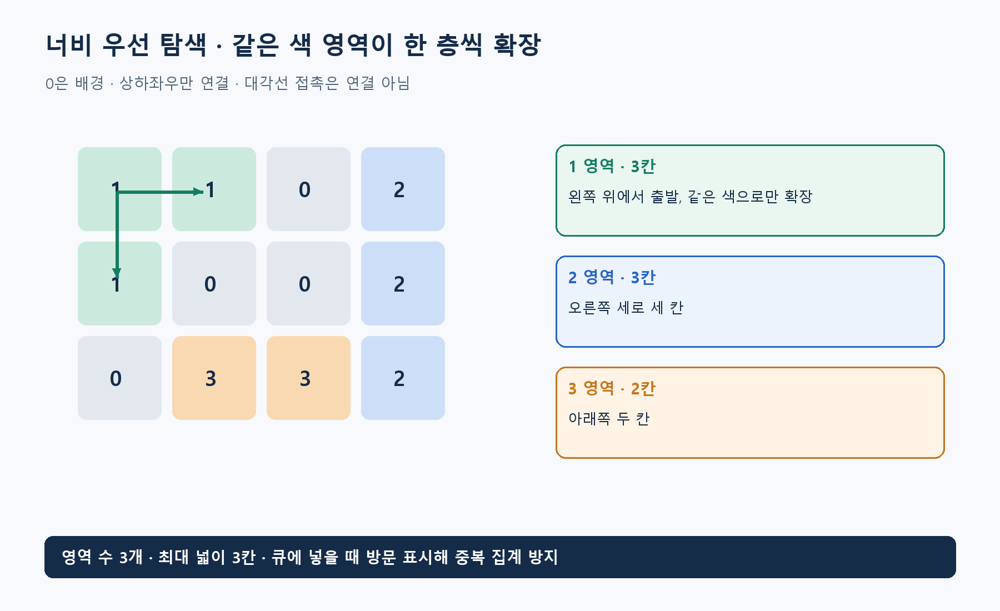

**알고리즘유형(엑셀 기준 적용 문제유형):** 영상·격자 영역 분석 / 상태 공간·퍼즐 탐색

**알고리즘 대표도:** **5/5**

> 유형은 이 알고리즘이 등장하는 문제상황의 분류. 대표도는 인지도·보편성·검증 수준에 대한 기존 엑셀의 정성 평가이며, 5일수록 높음.

# BFS(Breadth-First Search, 너비 우선 탐색)

## 1. 한 문장으로 이해하기

**시작점에서 한 번에 도달하는 곳, 두 번에 도달하는 곳을 차례대로 넓혀 가는 그래프 탐색.** BFS는 Breadth-First Search(너비 우선 탐색)의 약자. 먼저 들어온 항목을 먼저 꺼내는 큐가 핵심. [1]

- 모든 이동 비용이 같을 때 최소 이동 횟수를 구함.
- 같은 규칙으로 연결된 셀을 묶는 영역 탐색에도 사용 가능.

## 2. 언제 쓰는가

- 비가중 그래프의 최단 단계 수, 동일 비용 격자 이동, 연결 영역, 퍼즐의 최소 교환 횟수.
- 입력: 정점 또는 상태, 이웃을 만드는 규칙, 시작점, 통과 조건, 방문 여부를 구분하는 키.
- 이미지에서는 픽셀마다 이웃을 정하고 같은 색인지 검사. 4방향과 8방향의 선택은 결과를 바꾸는 문제 조건.
- 이동별 비용이 다르면 최소 단계가 최소 비용이 아닐 수 있음. 예를 들어 한 번 이동에 10, 두 번 이동의 합이 2라면 비용 목적에는 다른 방법 필요.
- 단일 출발점 거리 계산과 전체 영역 수 집계는 바깥 반복의 차이. 영역 집계는 미방문 셀마다 새 탐색을 시작해야 함.

## 3. 쉬운 로직과 숫자 예제

잉크 한 방울이 상하좌우로 같은 색 칸에만 번진다고 생각하면 됨. 이미 번진 칸은 다시 세지 않음.

```text
1 1 0 2
1 0 0 2
0 3 3 2
```

- 0은 배경, 같은 색의 상하좌우 접촉만 연결. 대각선 접촉은 무시.
- 왼쪽 위 1에서 시작하면 1 영역의 크기 **3**. 다른 미방문 색에서 계속하면 2 영역 크기 **3**, 3 영역 크기 **2**.
- 전체 영역은 **3개**, 가장 큰 영역은 **3칸**. 영역 탐색을 여러 번 하더라도 각 유효 셀은 한 번만 큐에 넣음.
- 이 예제는 색상 값 자체가 영역 번호와 우연히 일치. 떨어진 같은 색 덩어리 두 개는 서로 다른 영역이라는 점에 주의.



## 4. 상세 로직

1. 시작점을 방문 처리한 뒤 큐에 삽입. 거리 계산이라면 거리 0, 부모 없음으로 설정.
2. 큐 앞에서 정점을 꺼내 이웃 검사. 통과 가능하고 미방문이면 즉시 방문 처리 후 큐 뒤에 삽입.
3. 거리 문제에서는 `dist[v]=dist[u]+1`, 부모 v를 u로 기록. 큐가 거리 층 순서로 처리하므로 처음 발견한 거리가 최소 단계 수.
4. 영역 문제에서는 꺼낸 셀 수를 세고, 큐가 빌 때 해당 영역의 넓이 확정. 남은 미방문 셀에서 반복. [1][2]

```text
방문표 초기화; 영역수=0; 최대넓이=0
for 각 셀 s:
    if 배경이거나 이미 방문: continue
    영역수 += 1; 넓이=0
    방문[s]=참; 큐=[s]
    while 큐가 비지 않음:
        u=큐 앞에서 꺼내기; 넓이 += 1
        for u와 같은 색인 상하좌우 미방문 셀 v:
            방문[v]=참; 큐 뒤에 v 추가
    최대넓이=max(최대넓이,넓이)
return 영역수, 최대넓이
```

## 5. 대표 사례와 엑셀 연결

- 사례 **101**: 1,000×1,000 색상 격자의 영역 수와 최대 넓이. 좌표 경계·0 배경·4방향 조건을 정확히 반영.
- 사례 **109**: 8퍼즐 배열 하나를 상태로 보고 빈칸 교환을 간선으로 표현. 비용이 모두 1이므로 BFS로 최소 교환 횟수와 수순 복원 가능.
- 퍼즐은 이전에 나온 배열을 또 만들기 쉬움. 배열의 불변 표현이나 문자열을 방문 키로 사용.
- 비슷한 사례로 조직의 관계망에서 최소 연결 단계나 네트워크의 최소 홉 수 계산 가능. 실제 지연 시간이 다르면 다른 비용 모형 필요.

## 6. 왜 알려져 있는가

- 큐·그래프·최단 경로를 연결하는 기본 알고리즘으로 대학 자료구조 수업의 핵심 내용. Princeton 교재는 최단 간선 수 경로와 구현을 제공. [1][2]
- 인접 리스트에서 시간 `O(V+E)`, 추가 방문·거리·큐 공간은 `O(V)`. V는 정점 수, E는 간선 수.
- 격자의 이웃 수가 상수라면 전체 영역 탐색은 칸 수에 비례. 단, 이미지를 읽고 상태를 저장하는 비용도 실제 실행 시간에 포함해야 함.

## 7. 한계와 다른 방법의 차이

- DFS(Depth-First Search, 깊이 우선 탐색)도 연결 영역을 찾을 수 있지만, 일반적으로 발견한 경로가 최소 단계라는 보장은 없음.
- Dijkstra’s Algorithm(다익스트라 알고리즘)은 비음수 가중치에 맞춰 비용 순으로 처리. BFS의 선입선출 큐와 역할이 다름.
- 방문 처리를 꺼낼 때로 미루면 같은 셀이 큐에 중복 삽입될 수 있음. 큐에 넣을 때 표시하는 것이 단순하고 안전.
- 넓은 탐색 층에서는 큐가 커짐. 재귀 구현보다 반복 큐가 적절하며, 목록의 맨 앞 삭제가 비싼 자료구조는 피하기.

## 8. 실제 사용 전 확인

- 전체 배경, 한 칸 영역, 가장자리 영역, 같은 색의 분리된 영역, 대각선 접촉을 포함해 검산.
- 모든 영역 넓이 합이 배경 아닌 셀 수와 같은지 확인. 큰 영역 하나의 최대 큐 크기도 측정.
- 거리 문제는 복원 경로의 간선 수와 거리값 비교. 영역 번호는 탐색 순서에 따라 달라도 영역 분할은 같아야 함.
- 방문표를 새 출발점마다 초기화하지 않기. 전체 영역 집계에서는 탐색 간 공유해야 함.

### 연결된 엑셀 사례

- 사례 번호: **101, 109**. Top 1~5 출현 횟수: **2회**.
- 기준 자료: [알고리즘유형_신규상황_117개.xlsx](../알고리즘유형_신규상황_117개.xlsx)의 `문제상황 117개`·`알고리즘 집계` 시트. 적용 사례 설명은 모델링 해석이며, 해당 전체 데이터를 여기서 최적화한 결과는 아님.

### 참고자료

- [1] [Princeton Algorithms — Undirected Graphs](https://algs4.cs.princeton.edu/41graph/index.php): BFS와 최단 간선 수 경로.
- [2] [Princeton Algorithms — BreadthFirstPaths.java](https://algs4.cs.princeton.edu/41graph/BreadthFirstPaths.java.html): 큐, 방문 처리, 거리와 부모 기록.
- 확인일: 2026-11-05. 대학 강의·연구논문·공식 프로젝트 문서를 바탕으로 재서술. 숫자 예제와 그림은 자체 제작했으며 계산값을 별도로 검산. 의사코드는 개념 설명용.
