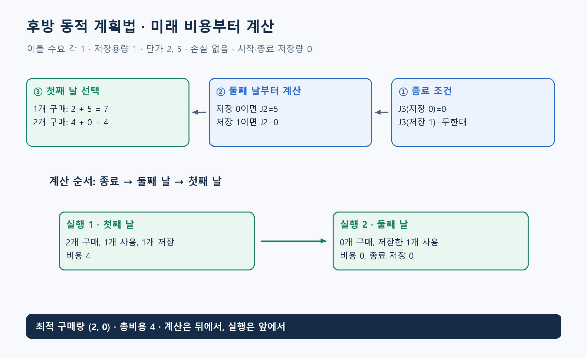

**알고리즘유형(엑셀 기준 적용 문제유형):** 상태별 순차 의사결정

**알고리즘 대표도:** **4/5**

> 유형은 이 알고리즘이 등장하는 문제상황의 분류. 대표도는 인지도·보편성·검증 수준에 대한 기존 엑셀의 정성 평가이며, 5일수록 높음.

# Backward Dynamic Programming(후방 동적 계획법)

## 1. 한 문장으로 이해하기

**마지막 시점의 비용부터 정한 뒤, ‘지금 비용+다음 상태의 최적 비용’을 비교하며 처음 시점까지 거꾸로 계산하는 동적 계획법.** 의사결정을 실제로 거꾸로 실행한다는 뜻은 아님. [1]

- 계산은 마지막에서 처음으로, 실행은 처음에서 마지막으로 진행.
- Dynamic Programming(동적 계획법)의 한 방식. 일반 동적 계획법과 별개의 독립 원리로 세면 안 됨.

## 2. 언제 쓰는가

- 기간이 정해진 재고, 설비 교체, 에너지 저장처럼 현재 결정이 다음 상태를 바꾸고 비용이 여러 시점에 걸쳐 누적될 때.
- 입력: 시점, 상태, 가능한 행동, 상태 전이, 단계 비용, 종료 비용 또는 종료 조건. 확률 모형이면 전이 확률도 필요.
- 상태는 미래 비용에 필요한 과거 정보를 요약해야 함. 누적 사용량 제한이 있다면 현재 저장량만으로는 부족할 수 있음.
- 시간·상태·행동을 적당한 크기의 유한 집합으로 만들 수 있을 때 계산이 직접적. 연속 상태를 나누면 원래 문제와 다른 근사 모형이 될 수 있음.
- 마지막 재고를 강제로 0으로 만들지, 잔존가치를 인정할지에 따라 첫날의 최적 선택도 달라짐.

## 3. 쉬운 로직과 숫자 예제

이틀간 전력을 구매한다고 하자. 하루 수요 1단위, 저장용량 1, 손실 없음, 구매량은 0·1·2 중 선택. 첫날·둘째 날 단가는 각각 2와 5. 시작과 종료 저장량은 0.

- 둘째 날 시작 저장량 0이면 1단위 구매해야 하므로 이후 최소비용 **5**.
- 둘째 날 시작 저장량 1이면 저장 전력으로 수요를 충족하므로 이후 최소비용 **0**.
- 첫날 1단위만 사면 `2+5=7`. 첫날 2단위를 사서 1단위를 저장하면 `4+0=4`.
- 따라서 구매계획 `(2,0)`, 총비용 **4**. 미래 가격과 마지막 저장 조건을 먼저 계산했기 때문에 현재 구매를 비교할 수 있음.
- 충방전 손실과 출력 한도를 단순화한 교육용 모형이며 실제 배터리의 모든 제약을 대표하지 않음.



## 4. 상세 로직

`J_t(s)`를 시점 t, 상태 s에서 마지막까지의 최소비용으로 정의. `a`는 행동, `c_t(s,a)`는 지금 비용, `F_t(s,a)`는 다음 상태.

1. 마지막 이후 값 `J_(T+1)` 설정. 예제에서는 저장량 0이면 0, 다른 종료 저장량은 무한대 비용.
2. `t=T,T−1,…,1` 순서로 각 상태를 계산.
3. 가능한 행동마다 `c_t(s,a)+J_(t+1)(F_t(s,a))` 비교하고 최소값과 그 행동 저장.
4. 시작 상태에서 저장된 행동을 따라 앞으로 움직여 실제 계획 복원.
5. 확률적 전이라면 다음 상태 값에 대한 기댓값 사용. 미래 정보가 관측되는 시점에 맞춰 허용 행동을 정의해야 함. [1][2]

```text
마지막 이후 상태별 종료비용 J[T+1] 초기화
for t = T부터 1까지 역순:
    for 가능한 상태 s:
        J[t,s]=무한대
        for s에서 실행 가능한 행동 a:
            다음=F(t,s,a)
            값=c(t,s,a)+J[t+1,다음]
            더 작으면 J[t,s]와 정책[t,s] 갱신
시작 상태부터 정책을 따라 행동과 상태를 복원
return 시작 상태의 값, 계획
```

## 5. 대표 사례와 엑셀 연결

- 사례 **11**: 압축기의 연령과 기종, 연도별 예산·공급능력을 상태와 행동에 반영해 교체 계획 검토.
- 기계 8대를 각자 최적으로 푼 결과를 합쳐도 공통 예산과 공급능력을 위반할 수 있음. 결합 제약이 있으면 공동 상태나 별도 결합 모형 필요.
- 사례 **14**: 시간·저장량·누적 방전량을 필요한 상태로 포함하고 충방전 행동 선택. 종료 시 초기 저장량으로 돌아오는 조건을 마지막 값에 반영.
- 대표 교과서 사례인 재고 구매와 설비 교체는 ‘오늘의 싸고 비쌈’만으로 결정할 수 없는 이유를 잘 보여줌.

## 6. 왜 알려져 있는가

- Bellman Principle of Optimality(벨먼 최적성 원리)를 유한 기간 문제에 직접 적용하는 구조. 최적제어 교재는 종료비용에서 시작하는 후방 재귀를 정리함. [1][2]
- 각 상태에서 할 행동까지 저장하면 단일 초기 상태의 계획뿐 아니라 상태 변화에 대응하는 정책도 얻을 수 있음.
- ‘뒤에서부터 계산’ 자체보다 미래에 필요한 정보를 상태에 빠짐없이 담는 설계가 정확성의 핵심.

## 7. 한계와 다른 방법의 차이

- 상태 변수가 늘면 조합 수가 급증하는 차원의 저주가 발생. 장비별 연령·예산·저장량을 모두 결합할 때 특히 주의.
- 유한 기간·결정적 전이에서 시점마다 상태 S개, 행동 A개라면 대략 `O(TSA)`. 확률 전이는 다음 상태 합산 비용이 추가.
- 값만 구하면 두 시점의 배열로 줄일 수 있지만, 정책 복원을 위해 선택 행동을 저장하면 추가 메모리 필요.
- 후방 계산은 일반 DP의 계산 순서 선택. 부분집합 DP는 상태 표현 방식이므로 둘은 같은 기준의 분류가 아님.

## 8. 실제 사용 전 확인

- 상태가 같은 두 경로의 미래 가능 행동·비용이 정말 같은지 확인. 다르면 상태에 누락 정보가 있는 것.
- 마지막 조건, 잔존가치, 할인율, 단위, 시점별 정보 공개 시점을 명시.
- 복원한 계획을 시작부터 재실행해 전이·제약·누적비용 검산.
- 작은 기간은 전체 행동 열거와 비교. 연속 상태를 이산화했다면 간격을 바꿔 결과의 민감도를 확인.

### 연결된 엑셀 사례

- 사례 번호: **11, 14**. Top 1~5 출현 횟수: **2회**.
- 기준 자료: [알고리즘유형_신규상황_117개.xlsx](../알고리즘유형_신규상황_117개.xlsx)의 `문제상황 117개`·`알고리즘 집계` 시트. 적용 사례 설명은 모델링 해석이며, 해당 전체 데이터를 여기서 최적화한 결과는 아님.

### 참고자료

- [1] [Harvard — The Optimal Control Formulation](https://hankyang.seas.harvard.edu/OptimalControlEstimation/formulation.html): 벨먼 원리, 종료비용, 유한 기간 후방 재귀.
- [2] [Bertsekas — Dynamic Programming and Optimal Control, short view](https://web.mit.edu/dimitrib/www/DP1_Short_View.pdf): 상태·행동·확률 전이·가법 비용의 모형.
- 확인일: 2026-11-05. 대학 강의·연구논문·공식 프로젝트 문서를 바탕으로 재서술. 숫자 예제와 그림은 자체 제작했으며 계산값을 별도로 검산. 의사코드는 개념 설명용.
