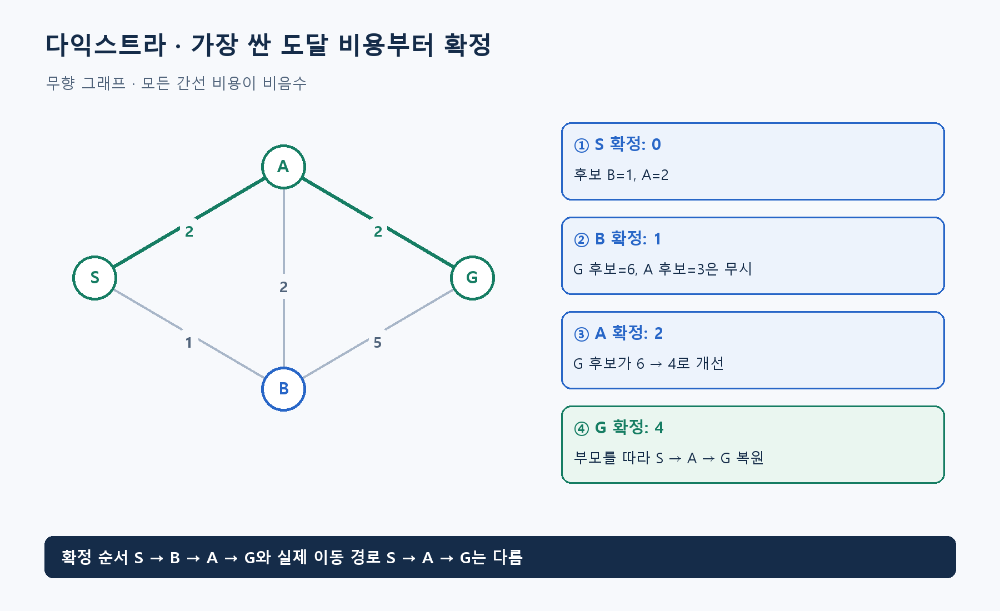

**알고리즘유형(엑셀 기준 적용 문제유형):** 경로·방문 순회

**알고리즘 대표도:** **5/5**

> 유형은 이 알고리즘이 등장하는 문제상황의 분류. 대표도는 인지도·보편성·검증 수준에 대한 기존 엑셀의 정성 평가이며, 5일수록 높음.

# Dijkstra's Algorithm(다익스트라 알고리즘)

## 1. 한 문장으로 이해하기

**출발점에서 현재까지 가장 싼 비용으로 도달할 수 있는 정점을 먼저 확정하며 최단 거리를 구하는 방법.** Dijkstra’s Algorithm(다익스트라 알고리즘)은 제안자의 이름을 딴 명칭. [1]

- 핵심 조건은 간선 가중치가 비음수라는 것. 0은 허용.
- 거리만 구하는 것과 실제 경로를 복원하는 것은 별도이므로 부모 정보도 저장.

## 2. 언제 쓰는가

- 거리·시간·비용이 이동 구간마다 다르고 모두 0 이상인 네트워크에서 한 출발점의 최단 경로를 찾을 때.
- 입력: 정점과 간선, 방향성, 간선 비용, 출발점, 필요하다면 목표점. 연결되지 않은 정점의 처리 규칙도 필요.
- 지도의 좌표 없이 도로 연결과 비용만 있어도 작동. 목표까지의 추정치를 요구하지 않음.
- 한 목적지만 필요하면 그 정점이 최소 비용으로 꺼내질 때 종료 가능. 모든 목적지의 거리가 필요하면 도달 가능한 정점 전체 처리.
- 모든 도로를 한 번 이상 지나야 하는 순회는 별도 문제. 다익스트라는 그 문제의 일부 거리 계산에 활용될 수 있음.

## 3. 쉬운 로직과 숫자 예제

물결이 출발점에서 퍼지되 긴 도로는 도달하는 데 더 오래 걸린다고 생각하면 됨. 먼저 도착한 정점부터 거리 확정.

- 무향 도로: `S-A=2`, `S-B=1`, `A-B=2`, `A-G=2`, `B-G=5`.
- S에서 시작해 B를 비용 **1**, A를 비용 **2**의 후보로 기록.
- B를 먼저 처리하면 G의 후보 비용은 `1+5=6`. A로 가는 후보 3은 기존 2보다 나빠 무시.
- 다음 A를 처리하면 G가 `2+2=4`로 개선. 마지막 G를 비용 **4**로 확정.
- 확정 순서는 `S→B→A→G`지만 최종 이동 경로는 **S→A→G**. 탐색 순서와 이동 경로를 혼동하지 않기.



## 4. 상세 로직

1. `dist[S]=0`, 다른 정점은 무한대. 최소 거리를 꺼낼 우선순위 큐 준비.
2. 큐에서 `(기록거리,u)`를 꺼내 최신 `dist[u]`보다 오래된 항목이면 건너뛰기.
3. 이웃 v마다 `dist[u]+w(u,v)`가 기존 거리보다 작으면 거리와 부모를 갱신. 이 연산을 Relaxation(완화)이라고 부름.
4. 갱신한 값을 큐에 넣고 반복. 목표 정점의 유효한 최소 항목을 꺼냈으면 그 거리 확정.
5. 부모를 거꾸로 따라 경로 복원. 도달 불가능한 정점은 무한대와 경로 없음으로 구분. [1][2]

```text
dist[S]=0; 나머지는 무한대; 큐=[(0,S)]
while 큐가 비지 않음:
    (d,u)=최소 거리 항목 꺼내기
    if d != dist[u]: continue
    if 단일 목표 탐색이고 u가 목표: 종료
    for 각 간선 (u,v,w):
        if d+w < dist[v]:
            dist[v]=d+w; 부모[v]=u
            큐에 (dist[v],v) 추가
return 거리와 부모
```

## 5. 대표 사례와 엑셀 연결

- 사례 **55**: 루마니아 지도나 지형 비용 격자의 최단 경로. A*와 같은 비용을 얻는지 비교할 기준 방법으로 활용.
- 격자에서는 이웃 칸 평균 비용이 간선 비용이라는 규칙을 그대로 사용. 칸 진입 비용으로 임의 변경하면 다른 문제를 풀게 됨.
- 사례 **51**: 무향 신문 배달 순회에서 홀수 차수 정점들 사이의 최단 거리를 계산하는 단계.
- 배달 순회 전체는 최소 가중 완전매칭으로 중복할 경로를 정하고, 중복 간선을 포함한 그래프에서 Eulerian Circuit(오일러 회로)을 만드는 단계까지 필요. 이 연결은 해당 사례 조건에 대한 문제 분해 설명.

## 6. 왜 알려져 있는가

- 비음수 가중 최단 경로의 표준적인 기본 알고리즘으로 교재와 라이브러리에서 널리 다뤄짐. Princeton은 이진 힙 기반 구현을 제공. [1][2]
- 서로 다른 분야의 비용을 ‘간선의 비음수 가중치’로 표현하면 같은 원리를 재사용 가능.
- 일반 인접 리스트와 힙 구현은 대략 `O((V+E)log V)` 수준. 중복 삽입 방식의 큐 크기와 복잡도는 구현·그래프 형태에 따라 달라짐.

## 7. 한계와 다른 방법의 차이

- 음수 간선이 있으면 한 번 확정한 거리가 나중에 줄어들 수 있어 표준 알고리즘의 전제가 깨짐. Bellman-Ford Algorithm(벨먼-포드 알고리즘) 등 다른 방법 검토.
- BFS(Breadth-First Search, 너비 우선 탐색)는 간선 수의 층 순서, A* Search(에이스타 탐색)는 누적 비용+남은 추정치 순서.
- 시작점이 여러 개면 초기에 모두 거리 0으로 넣는 다중 출발점 변형 가능. 모든 정점 쌍을 구하려면 규모에 맞춰 다른 구성 검토.
- 출발 시각에 따라 도로 시간이 달라지면 정적인 가중치 모델과 다름. 시간 의존 조건을 따로 검토해야 함.

## 8. 실제 사용 전 확인

- 음수 간선, 방향성, 중복 간선, 고립 정점, 시작=목표, 0 비용 간선을 확인.
- 복원 경로의 간선 비용 합이 보고된 최단 거리와 같은지 검산.
- 같은 비용의 여러 경로가 있으면 경로 모양보다 비용과 유효성을 비교. 임의의 사전순 우선 규칙을 정답 조건으로 추가하지 않기.
- 정수 범위 초과와 부동소수점 비교를 점검하고 오래된 큐 항목을 실제 재확장 수에 중복 집계하지 않기.

### 연결된 엑셀 사례

- 사례 번호: **51, 55**. Top 1~5 출현 횟수: **2회**.
- 기준 자료: [알고리즘유형_신규상황_117개.xlsx](../알고리즘유형_신규상황_117개.xlsx)의 `문제상황 117개`·`알고리즘 집계` 시트. 적용 사례 설명은 모델링 해석이며, 해당 전체 데이터를 여기서 최적화한 결과는 아님.

### 참고자료

- [1] [Princeton Algorithms — Shortest Paths](https://algs4.cs.princeton.edu/44sp/index.php): 비음수 조건, 완화, 최단 경로.
- [2] [Princeton Algorithms — DijkstraUndirectedSP](https://algs4.cs.princeton.edu/code/javadoc/edu/princeton/cs/algs4/DijkstraUndirectedSP.html): 이진 힙 구현, 복잡도, 수치 조건.
- 확인일: 2026-11-05. 대학 강의·연구논문·공식 프로젝트 문서를 바탕으로 재서술. 숫자 예제와 그림은 자체 제작했으며 계산값을 별도로 검산. 의사코드는 개념 설명용.
