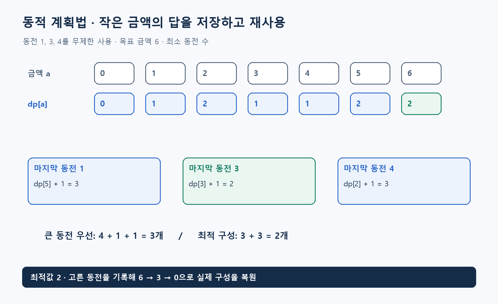

**알고리즘유형(엑셀 기준 적용 문제유형):** 선택·투자·자원 배분

**알고리즘 대표도:** **5/5**

> 유형은 이 알고리즘이 등장하는 문제상황의 분류. 대표도는 인지도·보편성·검증 수준에 대한 기존 엑셀의 정성 평가이며, 5일수록 높음.

# Dynamic Programming(동적 계획법)

## 1. 한 문장으로 이해하기

**큰 문제를 겹치는 작은 상태 문제로 나누고, 각 상태의 답을 저장해 반복 계산을 줄이는 설계 방법.** DP는 Dynamic Programming(동적 계획법)의 약자. 특정 문제에만 적용되는 하나의 고정 알고리즘은 아님. [1]

- 중요한 것은 표를 채우는 행위보다 **상태의 의미·점화식·초기값·계산 순서**.
- 같은 상태로 합친 두 경로는 이후 선택과 비용을 판단하는 데 필요한 정보가 같아야 함.

## 2. 언제 쓰는가

- 작은 문제의 최적 결과로 큰 문제의 최적 결과를 구성할 수 있고, 같은 작은 문제가 반복 등장하는 경우.
- 거스름돈, 배낭, 문자열 편집, 순차 의사결정 등이 대표적. 문제별로 상태와 점화식은 달라짐.
- 입력은 원래 자료 외에 상태 정의, 가능한 전이, 목표값, 불가능 상태 표현. 실제 구성까지 필요하면 부모 또는 선택 기록도 준비.
- 단순한 탐욕 선택에 반례가 있고 상태 수를 감당할 수 있다면 유력한 후보. ‘모든 최적화는 DP로 빠르게 풀린다’는 뜻은 아님.
- 상태를 과하게 합치면 정답을 잃고, 불필요한 과거까지 저장하면 계산량이 폭증. 필요한 정보만 남기는 설계가 핵심.

## 3. 쉬운 로직과 숫자 예제

동전 1·3·4를 무제한 사용해 금액 6을 최소 동전 수로 만든다고 하자.

- 큰 동전부터 쓰면 `4+1+1`, **3개**. 그러나 `3+3`은 **2개**이므로 탐욕법에 반례.
- `dp[a]`를 금액 a의 최소 동전 수로 정의. `dp[0]=0`.
- 금액 0~6의 값은 **0, 1, 2, 1, 1, 2, 2**.
- 금액 6에서 마지막 동전을 1·3·4라고 가정하면 각각 `dp[5]+1=3`, `dp[3]+1=2`, `dp[2]+1=3`. 가장 작은 2 선택.
- 값 2만 저장하면 동전 구성을 바로 알 수 없으므로 마지막에 고른 3도 저장. 6→3→0으로 복원하면 `3+3`.



## 4. 상세 로직

점화식은 `dp[a]=min(dp[a−c]+1)`이며 사용 가능한 양의 동전 c 중 `c≤a`인 것만 비교. 도달 불가능한 이전 금액은 제외. [2]

1. 상태가 어떤 질문의 답인지 한 문장으로 고정.
2. 마지막 선택 또는 첫 선택을 나누어 빠짐없이 비교하는 점화식 작성.
3. 초기 상태와 불가능 상태를 구분. 최소화에서 불가능을 0으로 두면 잘못된 후보가 이김.
4. 의존하는 작은 상태가 먼저 계산되게 순서 결정. 양의 동전에서는 금액 증가 순서.
5. 최적값과 선택을 저장하고 최종 상태에서 경로 복원. [1][2]

```text
dp[0]=0; 나머지 dp=무한대
for 금액 a = 1부터 목표까지:
    for 각 양의 동전 c:
        if c<=a 그리고 dp[a-c]가 도달 가능:
            후보=dp[a-c]+1
            if 후보<dp[a]: dp[a]=후보; 선택[a]=c
if dp[목표]가 무한대: 불가능 반환
선택을 따라 목표에서 0까지 금액을 줄이며 구성 복원
return 최소 개수, 구성
```

## 5. 대표 사례와 엑셀 연결

- 사례 **110**: 동전 20종, 목표 금액 10만 이하. 동전이 무제한이라는 조건이 위 점화식과 일치.
- 동전 개수가 제한되면 남은 개수 또는 품목 처리 단계를 반영한 다른 모형 필요. 같은 점화식을 그대로 쓰면 재고를 초과할 수 있음.
- 사례 **19**: 냉각계통 구간별 펌프 수를 선택. 처리한 구간 수·사용 예산·중량을 상태로 두고 구간 신뢰도를 결합.
- 독립 고장 가정에서 구간 성공확률을 계산해 전체 직렬 성공확률의 곱을 비교 가능. 로그 변환 시 성공확률 0의 처리가 별도로 필요.
- 두 사례가 모두 DP라고 해서 같은 코드를 재사용하는 것은 아님. 상태와 결합식이 다름.

## 6. 왜 알려져 있는가

- 작은 상태의 정의와 관계로 복잡한 문제를 푸는 기본 설계법이며, 대학 알고리즘 강의가 여러 문제를 통해 반복해서 가르치는 주제. [1]
- Top-Down Memoization(하향식 메모이제이션)과 Bottom-Up Tabulation(상향식 표 채우기)이라는 대표 구현 방식이 있음. 후자는 의존 순서, 전자는 재귀와 캐시 관리가 중요.
- 답뿐 아니라 구성·정책을 복원할 수 있어 실무 제출물과 연결하기 좋음. 단, 일반 DP라는 이름만으로 실행 시간과 정확성을 판단할 수 없음.

## 7. 한계와 다른 방법의 차이

- 위 동전 문제의 시간은 동전 종류 k와 목표액 A에 대해 `O(kA)`, 저장 공간은 `O(A)`.
- 입력 숫자의 비트 수가 아니라 금액 A 자체에 비례하므로 의사다항 시간. 목표액이 매우 크면 작동하기 어려움. [2][3]
- Greedy Algorithm(탐욕 알고리즘)은 매 단계 하나의 선택을 확정하는 방식. DP는 정의한 상태 안에서 여러 선택의 결과를 비교.
- 후방 DP는 시간의 계산 방향, 부분집합 DP는 상태 표현에 초점을 둔 변형. 이 문서의 일반 DP에 포함되는 개념.
- 계산 순서에 순환 의존이 생기면 단순히 한 번 표를 채우는 방식으로 해결되지 않을 수 있음.

## 8. 실제 사용 전 확인

- 상태 정의, 초기값, 전이, 최종 답 위치, 복원 방법을 먼저 적기.
- 목표 0, 만들 수 없는 금액, 중복 액면, 0·음수 액면의 입력 처리 확인.
- 복원한 동전 합과 개수가 목표액·보고값과 일치하는지 검산. 동률 최적 구성은 여러 개일 수 있음.
- 작은 범위 전체 열거와 비교하고, 최댓값 입력에서 상태 수·메모리·시간을 계산한 뒤 적용.

### 연결된 엑셀 사례

- 사례 번호: **19, 110**. Top 1~5 출현 횟수: **2회**.
- 기준 자료: [알고리즘유형_신규상황_117개.xlsx](../알고리즘유형_신규상황_117개.xlsx)의 `문제상황 117개`·`알고리즘 집계` 시트. 적용 사례 설명은 모델링 해석이며, 해당 전체 데이터를 여기서 최적화한 결과는 아님.

### 참고자료

- [1] [MIT 6.006 — Dynamic Programming Subproblems](https://ocw.mit.edu/courses/6-006-introduction-to-algorithms-spring-2020/28461a74f81101874a13d9679a40584d_MIT6_006S20_lec16.pdf): 상태, 관계, 계산 순서와 복원.
- [2] [MIT 6.006 — Making Change](https://courses.csail.mit.edu/6.006/spring08/problemsets/6/H12-ps6.pdf): 무제한 동전의 최소 개수, 점화식과 복원.
- [3] [MIT 6.006 — Recitation 19: Complexity](https://ocw.mit.edu/courses/6-006-introduction-to-algorithms-spring-2020/7232b0ff982f501556118a8552654762_MIT6_006S20_r19.pdf): 의사다항 시간과 입력 크기의 차이.
- 확인일: 2026-11-05. 대학 강의·연구논문·공식 프로젝트 문서를 바탕으로 재서술. 숫자 예제와 그림은 자체 제작했으며 계산값을 별도로 검산. 의사코드는 개념 설명용.
