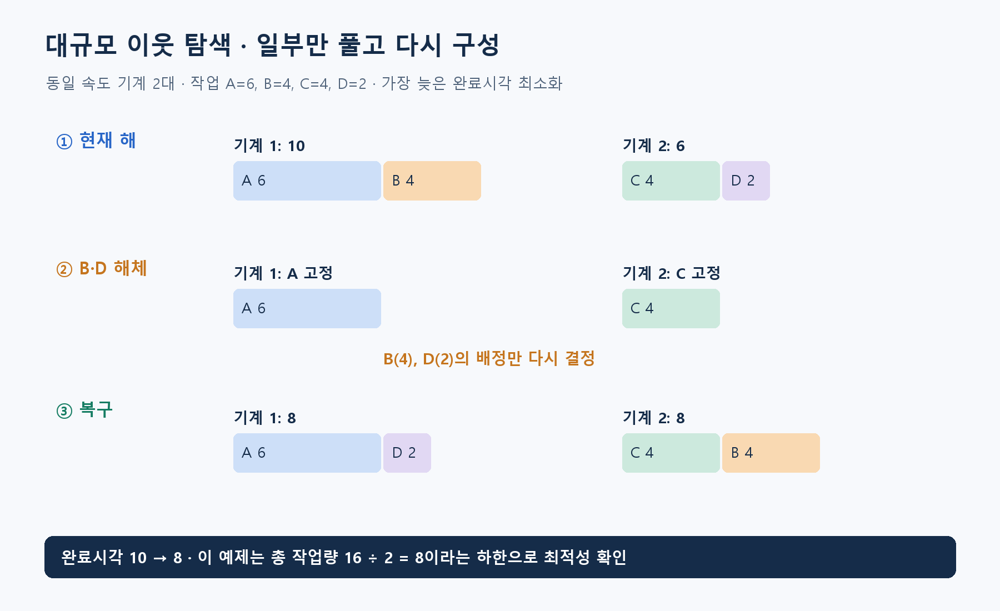

**알고리즘유형(엑셀 기준 적용 문제유형):** 순서·시간 편성

**알고리즘 대표도:** **4/5**

> 유형은 이 알고리즘이 등장하는 문제상황의 분류. 대표도는 인지도·보편성·검증 수준에 대한 기존 엑셀의 정성 평가이며, 5일수록 높음.

# LNS(Large Neighborhood Search, 대규모 이웃 탐색)

## 1. 한 문장으로 이해하기

**현재 해의 일부를 풀어 놓고, 나머지를 고정한 채 그 부분을 다시 구성해 더 좋은 해를 찾는 방법.** LNS는 Large Neighborhood Search(대규모 이웃 탐색)의 약자. [1]

- Destroy(해체): 기존 결정 일부를 미정으로 되돌림.
- Repair(복구): 풀어 놓은 결정을 제약에 맞게 다시 채움.
- 해체는 입력 자료를 삭제하는 행위가 아니라 탐색 중 결정변수의 고정을 해제하는 것.

## 2. 언제 쓰는가

- 근무표·배차·생산 일정처럼 실행 가능한 해를 만들 수 있지만, 작은 교환만으로 개선하기 어려운 조합 문제.
- 입력: 현재 해, 비용 함수, 필수 제약, 해체 대상 선택법, 복구 알고리즘, 후보 수락 규칙과 전체 시간.
- 서로 영향을 주는 작업·직원·기간을 함께 풀어 주면 개별 변경으로는 불가능한 재배치가 가능.
- 복구는 빠른 탐욕 삽입일 수도 있고 작은 정수모형의 정확 풀이일 수도 있음. 특정 솔버 하나로 정의되는 알고리즘이 아님.
- 해체 범위가 작으면 변화가 제한되고 너무 크면 원래 문제를 계속 처음부터 푸는 것과 비슷해짐. [1]

## 3. 쉬운 로직과 숫자 예제

레고 전체를 해체하지 않고 잘못 연결된 부분만 다시 조립하는 방식. 가공기 2대에 작업 A=6, B=4, C=4, D=2시간을 배정한다고 하자. 작업은 분할 불가, 두 기계의 속도는 같음.

- 현재 배정: 기계 1은 A+B로 **10시간**, 기계 2는 C+D로 **6시간**. 가장 늦은 완료시각 10.
- B와 D의 배정만 해제하고 A는 기계 1, C는 기계 2에 고정.
- 복구: 기계 1에 D, 기계 2에 B를 넣으면 **8시간·8시간**. 완료시각이 **8**로 개선.
- 총 작업량 16/기계 2=8은 하한. 이 작은 예제는 8을 달성해 별도로 최적성을 확인할 수 있음. 일반 LNS가 자동으로 최적성을 증명한다는 뜻은 아님.



## 4. 상세 로직

1. 필수 제약을 만족하는 초기해를 준비하고 최고 해 저장.
2. 비용이 큰 부분, 서로 관련된 작업, 무작위 부분 등으로 해체 집합 선택.
3. 선택한 결정만 풀고 나머지를 고정. 고정 부분과의 용량·연속 근무 등 연결 제약도 복구 문제에 남겨야 함.
4. 제한 시간 안에 복구해 후보 생성. 복구 실패 시 해당 후보 폐기 또는 정한 예외 절차 수행.
5. 개선 시 수락하거나 명시한 확률 규칙으로 수락. 최고 해는 따로 갱신. 종료까지 해체·복구 반복. [1]

```text
현재=실행 가능한 초기해; 최고=현재
while 전체 시간 한도 이내:
    풀어줄 결정 집합 선택
    나머지를 고정한 부분 문제 구성
    후보=부분 문제를 제한 시간 안에 복구
    if 복구 실패 또는 필수 제약 위반: continue
    if 수락 규칙 만족: 현재=후보
    if 후보가 최고보다 좋음: 최고=후보
return 최고, 개선 이력
```

## 5. 대표 사례와 엑셀 연결

- 사례 **01**: 특정 주의 교대표나 야간근무가 집중된 직원들의 배정을 함께 해제. 복구 시 자격별 필요 인원과 앞뒤 날짜 휴식 조건까지 검사.
- 사례 **08**: 정비 작업 일부의 실시 주를 풀고 다시 배치. 주간 인력 한도와 주별 공통 중단비용을 함께 계산.
- 대표 연구 적용은 시간창이 있는 운송·일정 문제. 후속 ALNS(Adaptive Large Neighborhood Search, 적응형 대규모 이웃 탐색)는 여러 해체·복구 방법의 사용 빈도를 성과에 따라 조정. [2]
- 모든 LNS가 적응형인 것은 아님. 같은 해체·복구 규칙을 계속 쓰는 기본 방식도 LNS에 포함.

## 6. 왜 알려져 있는가

- 복잡한 제약을 작은 재최적화 문제에 맡기면서 현재의 좋은 결정을 보존할 수 있다는 점이 유용. 운송·일정 분야의 대표 메타휴리스틱 문헌에서 다뤄짐. [1]
- Ropke·Pisinger의 연구는 시간창 운송 문제에 여러 경쟁 연산자를 적용한 적응형 변형을 제시. 해당 문제군의 실험 결과이며 모든 기업 문제에서의 성능 보장은 아님. [2]
- 직접 모든 큰 이웃을 나열하지 않고 복구 절차를 통해 그 안을 탐색하는 구조가 특징.

## 7. 한계와 다른 방법의 차이

- 복구 문제를 정확히 풀어도 고정된 결정 밖까지 포함한 전체 최적성은 보장되지 않음.
- 개선이 없다는 이유만으로 최적해라고 결론 내릴 수 없음. 해체 집합 선택이 같은 지역만 반복할 수도 있음.
- SA(Simulated Annealing, 모의 담금질)는 악화 후보의 수락 방식을 제공하고 LNS와 결합 가능. 두 방법은 서로 배타적 선택지가 아님.
- 복구 시간과 전체 반복 수 사이에 균형 필요. 한 번의 복구에 예산을 다 쓰면 다양한 이웃을 시험하지 못함.
- 서로 다른 제약의 위반을 하나의 벌점으로 섞으면 실제 필수 조건을 위반한 해가 채택될 수 있어 별도 실행 가능성 검사가 중요.

## 8. 실제 사용 전 확인

- 해체 비율, 선택 규칙, 복구 한도, 수락 규칙, 난수 시드를 기록.
- 부분 문제를 만들 때 고정 부분과 연결된 조건이 누락되지 않았는지 검토.
- 최종 배정의 중복·누락·용량·휴식 조건과 목적값을 전체 데이터로 다시 계산.
- 같은 전체 시간으로 단순 교환 탐색과 비교하고 여러 시드의 최고·중앙값·개선량을 보고. 증명된 하한이 있으면 그 차이를 함께 표시.

### 연결된 엑셀 사례

- 사례 번호: **01, 08**. Top 1~5 출현 횟수: **2회**.
- 기준 자료: [알고리즘유형_신규상황_117개.xlsx](../알고리즘유형_신규상황_117개.xlsx)의 `문제상황 117개`·`알고리즘 집계` 시트. 적용 사례 설명은 모델링 해석이며, 해당 전체 데이터를 여기서 최적화한 결과는 아님.

### 참고자료

- [1] [Pisinger & Ropke — Large Neighborhood Search](https://backend.orbit.dtu.dk/ws/files/5293785/Pisinger.pdf): 해체·복구, 이웃 크기, 기본 구조.
- [2] [Ropke & Pisinger — Adaptive LNS for Pickup and Delivery with Time Windows](https://pubsonline.informs.org/doi/pdf/10.1287/trsc.1050.0135): 적응형 연산자 선택과 운송 문제 연구 사례.
- 확인일: 2026-11-05. 대학 강의·연구논문·공식 프로젝트 문서를 바탕으로 재서술. 숫자 예제와 그림은 자체 제작했으며 계산값을 별도로 검산. 의사코드는 개념 설명용.
