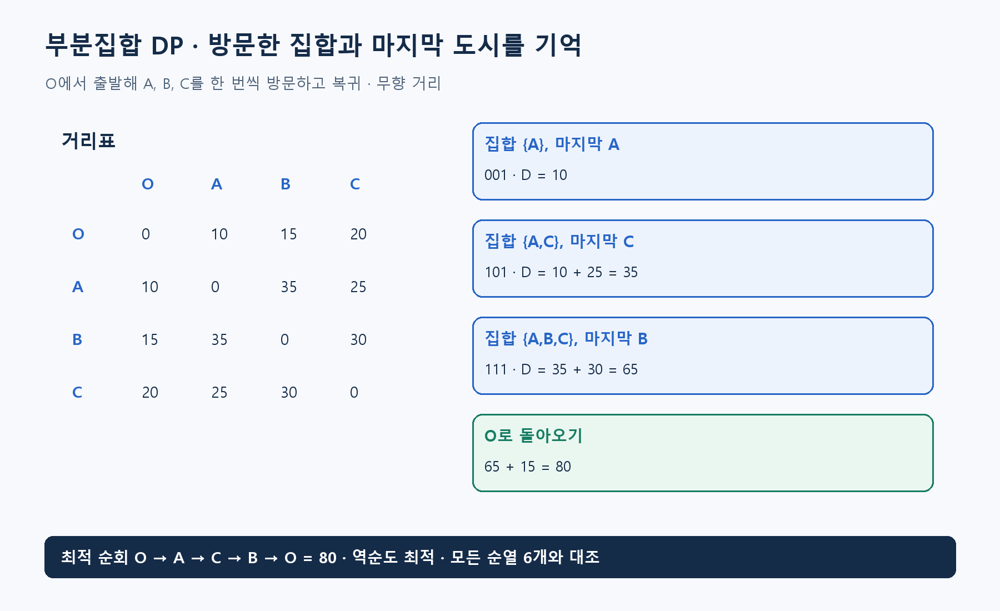

**알고리즘유형(엑셀 기준 적용 문제유형):** 용량별 묶음·공정 구성 / 선택·투자·자원 배분

**알고리즘 대표도:** **4/5**

> 유형은 이 알고리즘이 등장하는 문제상황의 분류. 대표도는 인지도·보편성·검증 수준에 대한 기존 엑셀의 정성 평가이며, 5일수록 높음.

# Subset Dynamic Programming(부분집합 동적 계획법)

## 1. 한 문장으로 이해하기

**어떤 대상을 이미 선택하거나 방문했는지를 부분집합으로 기억하고, 같은 집합 상태의 계산을 재사용하는 동적 계획법.** Bitmask DP(비트마스크 동적 계획법)는 집합을 비트로 표현하는 흔한 구현 방식. [1]

- 집합만으로 미래가 결정되지 않으면 마지막 위치·남은 자원 같은 정보도 상태에 포함.
- 일반 Dynamic Programming(동적 계획법)의 특수한 상태 설계 방식이며, 모든 부분집합 문제의 단일 알고리즘 이름은 아님.

## 2. 언제 쓰는가

- 방문 순회, 선후 제약 선택, 작은 집합의 배정처럼 ‘무엇을 했는가’가 중요하고 대상 수가 비교적 작을 때.
- 입력: 대상 목록, 집합에 대상을 추가할 수 있는 조건, 전이 비용, 상태별 추가 정보, 시작·종료 조건.
- n개 대상의 부분집합은 `2^n`개. 같은 n이라도 상태당 추가 차원과 전이 수에 따라 가능 규모가 달라짐.
- 수백 개 대상에 모든 부분집합을 만들겠다는 계획은 먼저 메모리부터 계산해야 함. 저장 표현이 비트라고 전체 상태 수까지 작아지는 것은 아님.
- 방문 여부만 같아도 마지막 도시가 다르면 다음 이동비가 달라지므로 서로 다른 상태로 보존해야 함.

## 3. 쉬운 로직과 숫자 예제

출발점 O에서 A·B·C를 한 번씩 방문하고 돌아오는 순회를 생각하자. 무향 거리 `OA=10, OB=15, OC=20, AB=35, AC=25, BC=30`.

- `D[S,j]`: O에서 출발해 집합 S의 도시를 정확히 방문하고 j에서 끝나는 최소비용.
- A만 방문하면 `D[{A},A]=10`.
- A,C를 방문하고 C에서 끝나면 `D[{A,C},C]=10+25=35`.
- 여기에 B를 붙이면 `D[{A,B,C},B]=35+30=65`. O로 복귀 15를 더해 **80**.
- 실제 최적 순회는 `O→A→C→B→O`, 또는 그 역순이며 비용 **80**. 가능한 6개 방문 순서를 전체 열거해 검산.
- 이 예제의 집합은 A=001, B=010, C=100으로 표현 가능. 101은 {A,C}를 뜻함.



## 4. 상세 로직

아래는 Traveling Salesperson Problem(외판원 문제)의 Held-Karp Dynamic Programming(헬드-카프 동적 계획법) 형태. 다른 문제에 적용할 때 점화식은 바뀜. [1][2]

1. 시작점을 집합 밖에 고정하고 `D[{j},j]=거리(O,j)`로 초기화.
2. 집합 크기가 작은 순서로 각 마지막 도시 j를 계산.
3. `D[S,j]=min(D[S−{j},i]+거리(i,j))`, 단 i는 `S−{j}`에 속함.
4. 모든 도시를 방문한 뒤 마지막 도시에서 O로 복귀하는 비용까지 더해 최소값 선택.
5. 최소값을 만든 이전 도시를 기록해 역순으로 복원. 마지막 복귀를 빼면 순환이 아닌 열린 경로 문제를 풀게 됨.

```text
모든 D=무한대
for 각 도시 j: D[{j},j]=거리(O,j)
for 집합 크기 = 2부터 전체 도시 수까지:
    for 해당 크기의 집합 S:
        for j in S:
            for i in S에서 j를 뺀 집합:
                후보=D[S-{j},i]+거리(i,j)
                더 작으면 D[S,j]와 이전 도시 갱신
답=min(D[전체,j]+거리(j,O))
이전 도시를 따라 순회 복원
```

## 5. 대표 사례와 엑셀 연결

- 사례 **02**: 배치 완료한 작업 집합과 현재 작업대의 사용 시간 등을 상태에 포함. 새 작업은 선행 작업이 이미 배치됐는지 검사.
- 사례 **10**: 제거한 부품 집합을 기록하고 선행 부품이 모두 제거된 경우에만 다음 제거 허용. 총 작업시간과 회수 가치로 실행 가능성과 목적 평가.
- 두 사례에는 위 순회 점화식을 그대로 적용하지 않음. 방문 집합을 기억하는 설계 원리를 적용하고 작업대·시간 제약에 맞는 상태와 전이를 새로 정의.
- ‘부분집합 합’ 문제의 금액별 DP와도 구분. 집합을 입력으로 받는다고 모두 `2^n` 상태를 쓰는 것은 아님.

## 6. 왜 알려져 있는가

- 순열 `n!`개를 각자 끝까지 탐색하는 대신 같은 방문 집합·끝점을 공유하는 계산을 합칠 수 있다는 대표 사례. [1]
- 외판원 문제의 고전적인 정확 풀이로 알려져 있으며, 일반적인 헬드-카프 점화식은 시간 `O(n²2^n)`, 공간 `O(n2^n)` 수준. [2]
- 여전히 지수적이지만 작은 규모에서 정확한 비교 기준을 만들기 좋음. 큰 휴리스틱의 품질을 작은 사례로 검증할 때도 유용.

## 7. 한계와 다른 방법의 차이

- n이 늘 때 메모리가 급증. 전체 부분집합을 저장하는 표와 실제 도달 상태만 저장하는 사전의 장단점을 비교.
- 같은 집합이어도 누적 시간이나 마지막 위치가 달라 미래가 달라지면 하나로 합칠 수 없음. 비용이 작은 상태만 남기는 지배 규칙도 증명 필요.
- Backward Dynamic Programming(후방 동적 계획법)은 시점 역순 계산에 관한 이름. 부분집합 DP는 상태 표현에 관한 이름.
- 비트 연산의 빠르기가 지수적 상태 수를 없애지는 않음. 대상 번호와 비트 위치의 대응 오류도 흔한 구현 실수.

## 8. 실제 사용 전 확인

- 빈 집합, 단일 대상, 시작점 포함 여부, 종료 복귀 비용을 명시.
- n의 최대값으로 상태 수와 바이트 단위 메모리 추정. 전이 하나의 검사 비용도 포함.
- 복원 경로에서 누락·중복 방문과 선후 조건을 확인하고 목적값 재계산.
- 작은 n의 전체 순열·부분집합 열거와 비교. 대상 명칭이 바뀌어도 비트 번호만 일관되면 결과가 같아야 함.

### 연결된 엑셀 사례

- 사례 번호: **02, 10**. Top 1~5 출현 횟수: **2회**.
- 기준 자료: [알고리즘유형_신규상황_117개.xlsx](../알고리즘유형_신규상황_117개.xlsx)의 `문제상황 117개`·`알고리즘 집계` 시트. 적용 사례 설명은 모델링 해석이며, 해당 전체 데이터를 여기서 최적화한 결과는 아님.

### 참고자료

- [1] [University of Central Florida — DP Algorithm for Traveling Salesman Problem](https://cs.ucf.edu/~dmarino/progcontests/modules/dptsp/DP-TSP-Notes.pdf): 부분집합 상태, 비트 표현, 순회 점화식.
- [2] [Stoian — TSP Escapes the O(2^n n²) Curse](https://arxiv.org/abs/2405.03018): 배경 설명의 고전적 벨먼·헬드-카프 DP와 복잡도; 신기법 자체는 본문 범위 밖.
- 확인일: 2026-11-05. 대학 강의·연구논문·공식 프로젝트 문서를 바탕으로 재서술. 숫자 예제와 그림은 자체 제작했으며 계산값을 별도로 검산. 의사코드는 개념 설명용.
