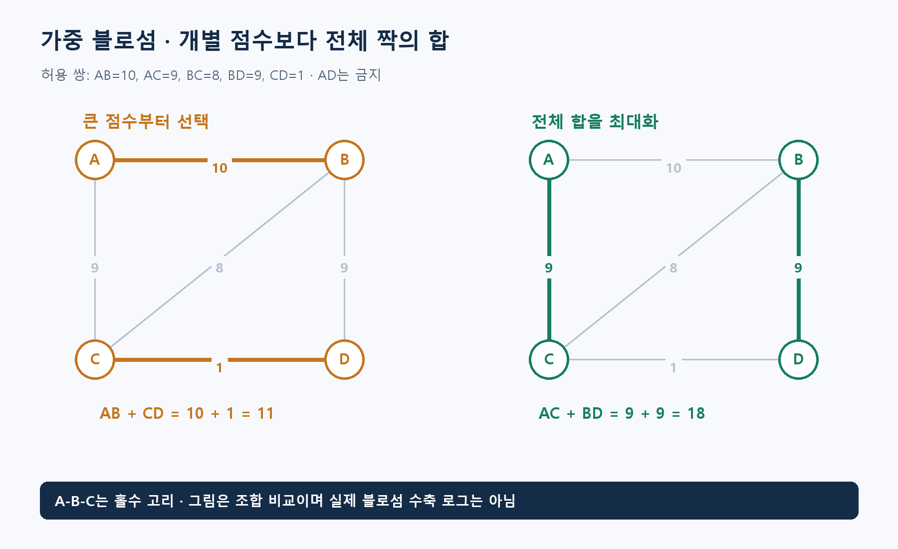

**알고리즘유형(엑셀 기준 적용 문제유형):** 짝짓기·매칭 / 경로·방문 순회

**알고리즘 대표도:** **4/5**

> 유형은 이 알고리즘이 등장하는 문제상황의 분류. 대표도는 인지도·보편성·검증 수준에 대한 기존 엑셀의 정성 평가이며, 5일수록 높음.

# Weighted Blossom Algorithm(가중 블로섬 알고리즘)

## 1. 한 문장으로 이해하기

**일반 무향 그래프에서 서로 겹치지 않는 쌍을 골라 가중치 목적을 최적화하는 매칭 알고리즘 계열.** 홀수 길이 고리인 Blossom(꽃)을 처리하는 구조와 가중치의 원시-쌍대 조건을 결합. [1]

- 매칭: 한 정점이 최대 한 쌍에만 참여하도록 선택한 간선 집합.
- 먼저 결정할 것: 쌍 수 최대화, 점수 합 최대화, 모든 사람의 완전매칭 중 비용 최소화는 서로 다른 목적.

## 2. 언제 쓰는가

- 참가자 짝짓기, 호환 부품의 쌍 구성, 일반 그래프의 비용 있는 매칭처럼 대상을 두 개씩 묶는 상황.
- 입력: 대상 정점, 허용 쌍의 간선, 각 간선의 점수·비용, 최대/최소 방향, 쌍 수 우선 여부.
- 사람들을 왼쪽·오른쪽 두 집단으로 나누고 집단 사이 연결만 허용하는 이분 그래프라면 전용 매칭 방법도 검토.
- 세 사람씩 묶기, 한 사람이 여러 쌍에 참여하기, 팀 전체 예산 같은 제약은 기본 일반 매칭과 다른 모형일 수 있음.
- 금지 쌍은 간선 자체를 빼는 것이 명확. 낮은 점수를 주기만 하면 쌍 수 우선 목적에서 선택될 수 있음.

## 3. 쉬운 로직과 숫자 예제

A·B·C·D를 중복 없이 짝지어 점수 합을 최대화. 허용 점수는 `AB=10, AC=9, BC=8, BD=9, CD=1`, AD는 금지.

- 가장 높은 AB=10부터 고르면 남은 C,D는 1이어서 합 **11**.
- AC=9와 BD=9를 선택하면 합 **18**. 두 간선은 정점이 겹치지 않아 유효.
- 가능한 두 쌍 구성은 AB+CD와 AC+BD뿐이므로 최적값 **18**. 단일 쌍도 18보다 작음.
- A-B-C는 홀수 고리. 이런 구조가 존재하면 두 집단 전용 매칭의 단순 탐색을 그대로 적용하기 어려움.
- 그림은 최적 조합과 홀수 고리의 존재를 설명하며, 실제 블로섬 수축의 반복 로그를 나타내지는 않음.



## 4. 상세 로직

일반 가중 블로섬의 구현은 짧은 탐욕법보다 복잡. 아래는 개념 순서이며 라이브러리를 대체할 완전한 구현 명세는 아님. [1][3]

1. 매칭과 쌍대 정보를 초기화. 쌍대 조건으로 계산되는 간선 여유를 관리.
2. 조건을 만족하는 간선에서 매칭 간선과 비매칭 간선을 번갈아 따라가는 교대 탐색 구조 생성.
3. 적절한 홀수 교대 고리를 만나면 하나의 블로섬으로 수축해 상위 탐색을 진행. 복원에 필요한 내부 구조 보존.
4. 증가 경로를 찾으면 경로의 선택·비선택 간선을 뒤집어 매칭 갱신.
5. 더 진행하기 어려우면 쌍대값을 조정해 새 간선을 활성화하거나 블로섬을 확장. 가중 목적의 최적성 조건까지 확인하며 반복.
6. 수축을 풀어 원래 정점의 매칭 반환. 단순히 최대 간선 가중치로 고리를 압축하는 것은 올바른 가중 블로섬 구현이 아님.

```text
목적 방향과 쌍 수 우선 여부를 명시
허용 간선만으로 무향 그래프 구성
가중 블로섬 구현에 그래프와 목적 전달
반환한 각 쌍이 실제 허용 간선인지 확인
정점이 둘 이상의 쌍에 쓰이지 않았는지 확인
쌍 수와 원래 가중치 합을 별도로 재계산
완전매칭 요구 시 모든 정점이 짝지어졌는지 확인
```

## 5. 대표 사례와 엑셀 연결

- 사례 **34**: 참가자 23명은 모두 짝지을 수 없음. 먼저 쌍 수 최대화, 그 안에서 협업 점수 최대화이므로 두 목적의 우선순위를 유지.
- NetworkX의 `max_weight_matching(..., maxcardinality=True)`는 최대 쌍 수를 우선한 뒤 가중치 합을 최대화. 기본 설정과 다른 의미이므로 명시 필요. [1]
- 사례 **51**: 무향 신문 배달 순회에서는 홀수 차수 정점들 사이 최단 거리로 완전 그래프를 만든 뒤 최소 가중 완전매칭 수행.
- 매칭된 정점 쌍 사이의 원래 최단 경로를 중복시키면 모든 차수가 짝수가 됨. 이후 Eulerian Circuit(오일러 회로)을 구성. 도로 전체 순회는 이 여러 단계의 결합.
- 최소화 라이브러리를 쓸 때도 ‘최대 쌍 수 중 최소 비용’인지 ‘쌍 수 제한 없는 최소 비용’인지 확인해야 함. [2]

## 6. 왜 알려져 있는가

- 홀수 고리가 있는 일반 그래프의 매칭을 다루는 핵심 방법이며, 가중치까지 고려한 검증된 구현이 공개돼 있음. [1][3]
- 큰 점수의 간선을 순서대로 고르는 방식과 달리 전체 조합의 최적성을 다룸. 일반 매칭이 이분 매칭보다 구조적으로 어려운 이유를 설명하는 대표 주제.
- 일반 대중의 인지도보다는 그래프 최적화 분야에서의 중요성이 큼. 문서 상단 대표도는 기존 엑셀의 정성 평가값.

## 7. 한계와 다른 방법의 차이

- Blossom Algorithm(블로섬 알고리즘)의 비가중 최대 쌍 수 문제와 가중 최대 점수 문제를 혼동하지 않기.
- ‘더 추가할 간선이 없는 매칭’인 극대매칭은 최대매칭과 다름. 작은 점수·쌍 수에 갇힐 수 있음.
- NetworkX 문서의 해당 구현 시간은 `O(V³)`. 모든 블로섬 변형의 복잡도가 같다는 뜻은 아님. [1]
- 부동소수점 가중치는 수치 오차로 약간 덜 좋은 결과를 만들 수 있다는 구현상 주의가 있음. 의미를 보존할 수 있으면 정수 점수 사용 검토.

## 8. 실제 사용 전 확인

- 허용 쌍·방향성·목적 우선순위를 먼저 고정하고 최대 쌍 수와 총점 둘 다 기록.
- 홀수 정점 수, 고립 정점, 금지 쌍, 동점, 음수 점수, 완전매칭 불가능 사례를 점검.
- 작은 그래프는 모든 매칭을 열거해 비교. 순회 문제는 매칭 비용뿐 아니라 중복 경로와 최종 순회 길이까지 검산.
- 내부 알고리즘을 짧게 재구현하기보다 검증된 구현을 사용하고, 버전·옵션과 목적 변환을 기록.

### 연결된 엑셀 사례

- 사례 번호: **34, 51**. Top 1~5 출현 횟수: **2회**.
- 기준 자료: [알고리즘유형_신규상황_117개.xlsx](../알고리즘유형_신규상황_117개.xlsx)의 `문제상황 117개`·`알고리즘 집계` 시트. 적용 사례 설명은 모델링 해석이며, 해당 전체 데이터를 여기서 최적화한 결과는 아님.

### 참고자료

- [1] [NetworkX — max_weight_matching](https://networkx.org/documentation/stable/reference/algorithms/generated/networkx.algorithms.matching.max_weight_matching.html): 목적 우선순위, 블로섬·원시-쌍대 기반, 복잡도와 수치 조건.
- [2] [NetworkX — min_weight_matching](https://networkx.org/documentation/stable/reference/algorithms/generated/networkx.algorithms.matching.min_weight_matching.html): 최대 쌍 수 중 최소 가중치 매칭의 정의.
- [3] [NetworkX — matching implementation](https://networkx.org/documentation/stable/_modules/networkx/algorithms/matching.html): 교대 탐색, 블로섬 수축·확장과 쌍대 조정의 실제 구현.
- 확인일: 2026-11-05. 대학 강의·연구논문·공식 프로젝트 문서를 바탕으로 재서술. 숫자 예제와 그림은 자체 제작했으며 계산값을 별도로 검산. 의사코드는 개념 설명용.
